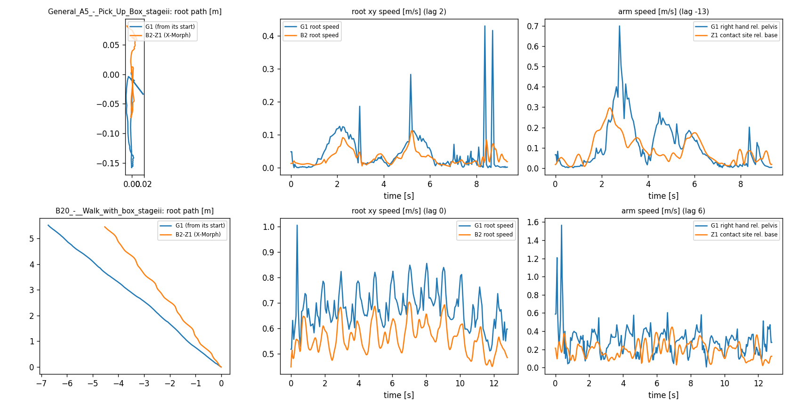

# X-Morph prior smoke test

Run `R000d_cloud_xmorph_smoke_cpu` · code `v0.1.0-1-g2c616eb` (dirty=False) · X-Morph match=True · device `cpu` · torch 2.7.1+cu126 cuda=False · mujoco 3.11.0

Pass/fail uses length, finiteness, quaternions and the root-speed lag (pipeline alignment). Arm lag, path ratio and heading drift describe X-Morph itself and are recorded only.

| clip | frames in / raw out / kept | runtime [s] | quat err | joint-limit viol. [rad] | lag root (corr) | arm lag, info (corr) | path G1 / B2 [m] | turn G1 / B2 [deg] | pass |
|---|---|---|---|---|---|---|---|---|---|
| General_A5_-_Pick_Up_Box_stageii | 281 / 284 / 281 | 3.1 | 5.1e-08 | 0.000 | 2 (0.71) | -13 (0.76) | 0.43 / 0.29 | 1 / 11 | True |
| B20_-__Walk_with_box_stageii | 385 / 388 / 385 | 2.7 | 3.3e-08 | 0.000 | 0 (0.78) | 6 (0.33) | 8.72 / 7.22 | 25 / 14 | True |

