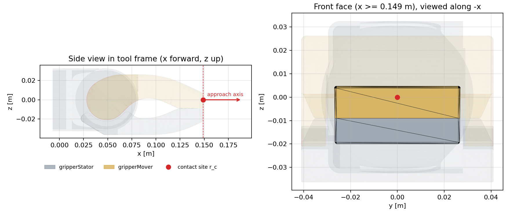

# B01 tool and collision geometry check

Run `R002_b01_mj311` · code `v0.1.0-1-g2c616eb` (dirty=False) · X-Morph `a9f4a77` (pinned match=True) · host `kevin-Legion-R9000P-ADR10`

| Check | Result | Pass |
|---|---|---|
| A. r_c on gripperMover surface | distance to mover 8.36e-10 m, to stator 9.00e-03 m | True |
| B. front face extents (union) | y [-0.0269, +0.0269] m, z [-0.0200, +0.0047] m; triangle area / extent area = 0.994 | info |
| C. r_c to convex hull | gripperStator: +8.22e-03 m, gripperMover: -8.36e-10 m | info |
| D. FK model vs full model | pos 9.44e-16 m, rot 2.41e-15 | True |
| E. Jacobians vs finite diff | max rel err 4.80e-07 | True |
| F. joint order | qpos[7:26] | True |

## Front face per link

| Link | triangles | area [cm^2] | y range [m] | z range [m] |
|---|---|---|---|---|
| gripperStator | 45 | 5.86 | [-0.02665548480494804, 0.026655484020447585] | [-0.02000445452012345, -0.008999998221861483] |
| gripperMover | 122 | 7.35 | [-0.02688369086010786, 0.02688369205887704] | [-0.008999999650614265, 0.004717909907931084] |

## Arm collision geoms

| geom | body | type |
|---|---|---|
| 65 | z1_mount_computer | mjGEOM_BOX |
| 67 | link00 | mjGEOM_CYLINDER |
| 69 | link01 | mjGEOM_CYLINDER |
| 71 | link02 | mjGEOM_CYLINDER |
| 72 | link02 | mjGEOM_CYLINDER |
| 74 | link03 | mjGEOM_CYLINDER |
| 76 | link04 | mjGEOM_CYLINDER |
| 78 | link05 | mjGEOM_CYLINDER |
| 80 | link06 | mjGEOM_CYLINDER |
| 82 | gripperStator | mjGEOM_MESH |
| 84 | gripperMover | mjGEOM_MESH |

