# FORCE data profile

Run `R004b_force_profile` · code `v0.1.1-9-g5c1e1a6` (dirty=False) · 398/398 clips · 696 hand-contact segments · 2.16 h · 49 clips without hand contact

## Checks

| check | value | pass |
|---|---|---|
| all_files_processed | `{"n_errors": 0}` | True |
| floor_at_zero | `{"threshold_m": 0.03, "objects": ["chair", "box_huge"], "failing_objects": [], "median_lowest_z_start_m": -0.013796023598860785, "median_toe_z_min_m": 0.015171442053239524}` | True |
| force_data_pinned | `{"actual": "695c8b8616f0915dd61658862751e40ec658b81c", "pinned": "695c8b8616f0915dd61658862751e40ec658b81c"}` | True |
| hand_annotation_agreement | `{"threshold": 0.8, "agreement": 0.88, "n_single_hand_with_contact": 75, "n_single_hand_without_contact": 35}` | True |
| hand_contact_found | `{"threshold": 0.9, "objects": ["box_huge", "chair"], "share": 0.9916666666666667, "share_by_object": {"suitcase": 0.7615894039735099, "chair": 0.9846153846153847, "plasticcontainer": 1.0, "box_huge": 1.0, "laundrybasket": 0.972972972972973, "backpack": 1.0}, "annotated_hand_dist_p10_by_object_m": {"suitcase": 0.013479368621804651, "chair": 0.001115849495937985, "plasticcontainer": 0.001905430171981517, "box_huge": 0.0012785362077048302, "laundrybasket": 0.057519998559973744, "backpack": 0.001365918136618651}}` | True |
| frame_rate_info | `{"assumed_src_fps": 60.0, "minutes_at_assumed_fps": 129.82722222222222, "paper_minutes_scaled_to_n_sequences": 125.14888888888889, "median_step_hz": 1.124637257943823, "note": "informational; a wrong fps scales both numbers"}` | True |

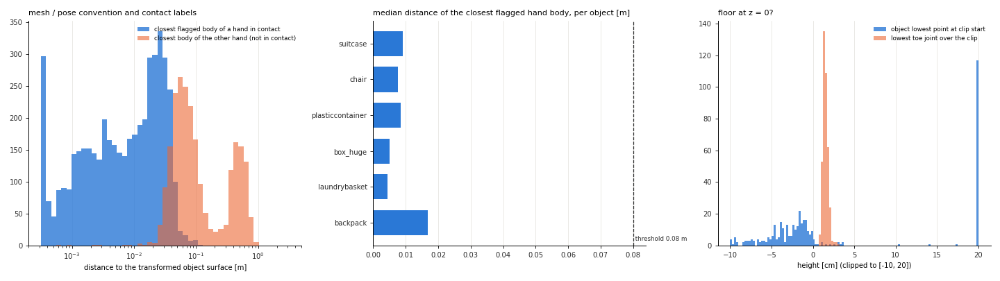

## Overview

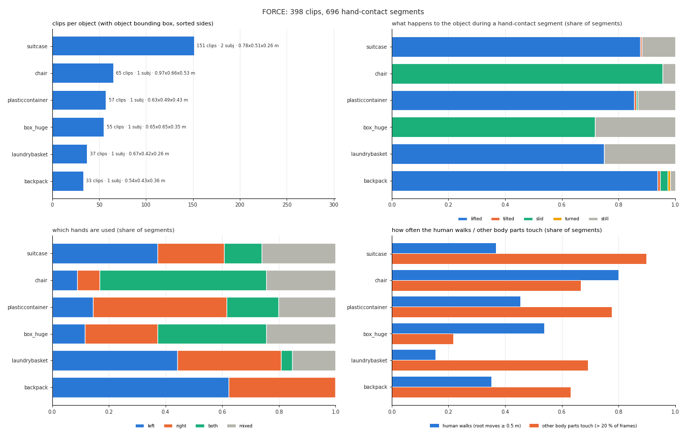

Shares of segments, in % (hands: L / R / both / mixed; object: lifted / tilted / slid / turned / still).

| object | clips | subj | size [m] | clip s | seg/clip | coverage | hands L/R/both/mixed | object li/ti/sl/tu/st | walk | other body | contact z [m] |
|---|---|---|---|---|---|---|---|---|---|---|---|
| suitcase | 151 | 2 | 0.78x0.51x0.26 | 13.5 | 1.25 | 22 | 37/23/13/26 | 88/1/0/0/12 | 37 | 90 | 0.92 |
| chair | 65 | 1 | 0.97x0.66x0.53 | 16.1 | 1.38 | 55 | 9/8/59/24 | 0/0/96/0/4 | 80 | 67 | 0.79 |
| plasticcontainer | 57 | 1 | 0.63x0.49x0.43 | 23.8 | 3.05 | 51 | 14/47/18/20 | 86/1/1/0/13 | 45 | 78 | 1.00 |
| box_huge | 55 | 1 | 0.65x0.65x0.35 | 14.8 | 1.42 | 31 | 12/26/38/24 | 0/0/72/0/28 | 54 | 22 | 0.62 |
| laundrybasket | 37 | 1 | 0.67x0.42x0.26 | 10.8 | 1.41 | 27 | 44/37/4/15 | 75/0/0/0/25 | 15 | 69 | 0.83 |
| backpack | 33 | 1 | 0.54x0.43x0.36 | 23.7 | 3.45 | 27 | 62/38/0/0 | 94/1/3/1/2 | 35 | 63 | 0.77 |

## Most common segment kinds per object (hands / object / human, share of the object's segments)

* **suitcase**: left / lifted / stand 20 %; right / lifted / stand 19 %; mixed / lifted / walk 17 %; left / lifted / walk 11 %
* **chair**: both / slid / walk 52 %; mixed / slid / walk 18 %; right / slid / walk 6 %; both / slid / stand 6 %
* **plasticcontainer**: right / lifted / stand 24 %; both / lifted / walk 17 %; mixed / lifted / walk 14 %; right / lifted / walk 11 %
* **box_huge**: both / slid / walk 21 %; mixed / slid / walk 15 %; both / still / stand 15 %; right / slid / walk 12 %
* **laundrybasket**: right / lifted / stand 35 %; left / still / stand 23 %; left / lifted / stand 21 %; mixed / lifted / walk 12 %
* **backpack**: left / lifted / stand 34 %; left / lifted / walk 25 %; right / lifted / stand 25 %; right / lifted / walk 10 %

## Distributions and body parts

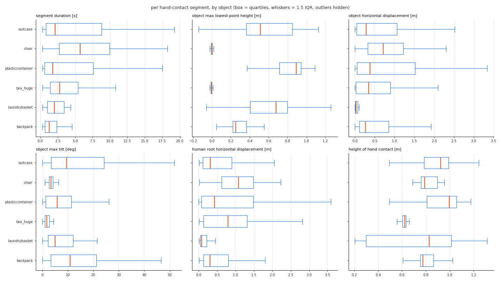

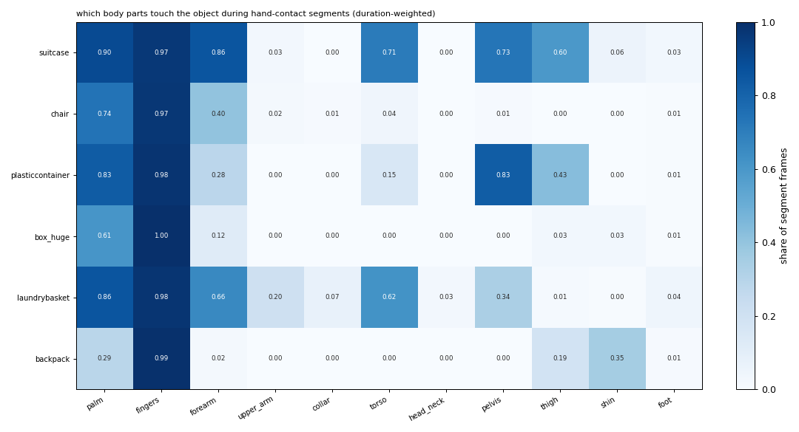

## Examples

Per object: most common and second most common (hands, object) of the clip's longest segment; the clip with the median duration in that group.

### suitcase #1: mixed / lifted (37 % of its clips) — `040723_7_2`

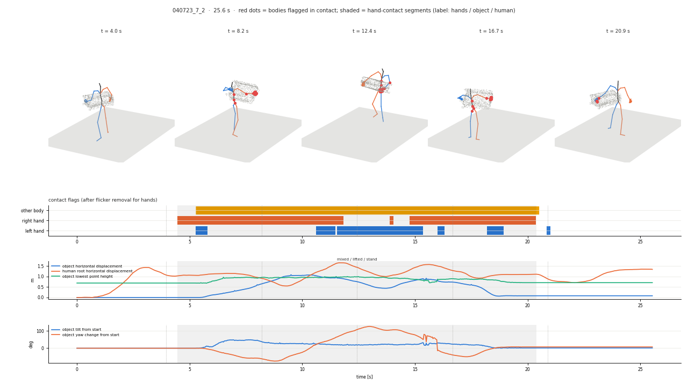

### suitcase #2: left / lifted (18 % of its clips) — `0630_27-2`

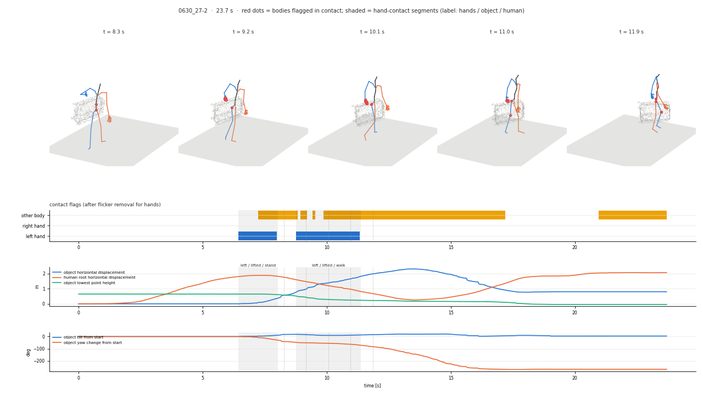

### chair #1: both / slid (72 % of its clips) — `260923_04_3_retake_2`

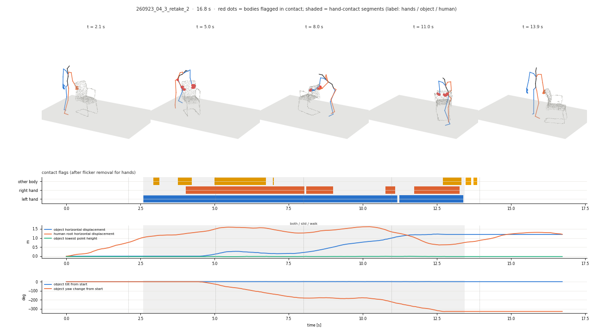

### chair #2: mixed / slid (23 % of its clips) — `260923_05_1_retake_2`

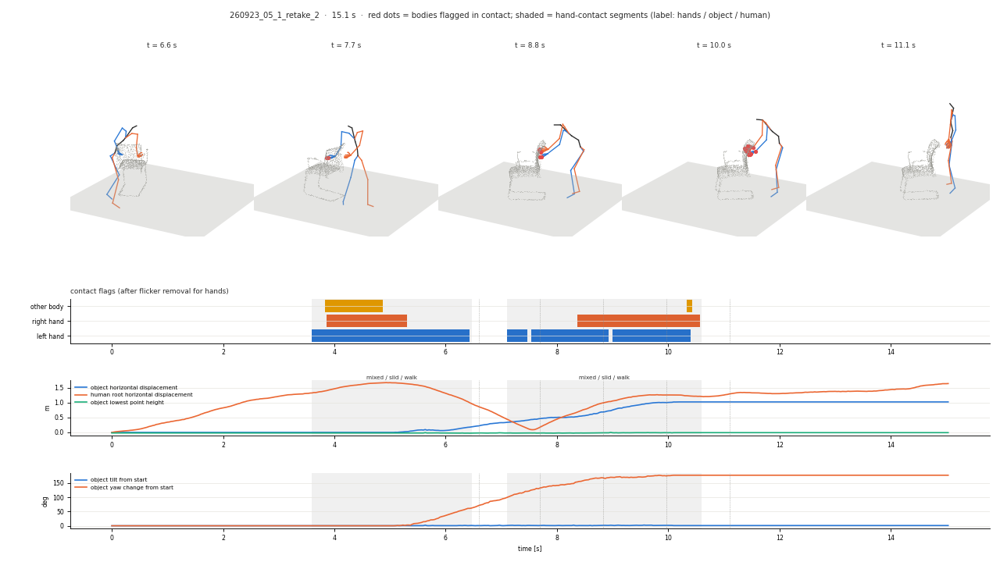

### plasticcontainer #1: mixed / lifted (35 % of its clips) — `0630_29-3`

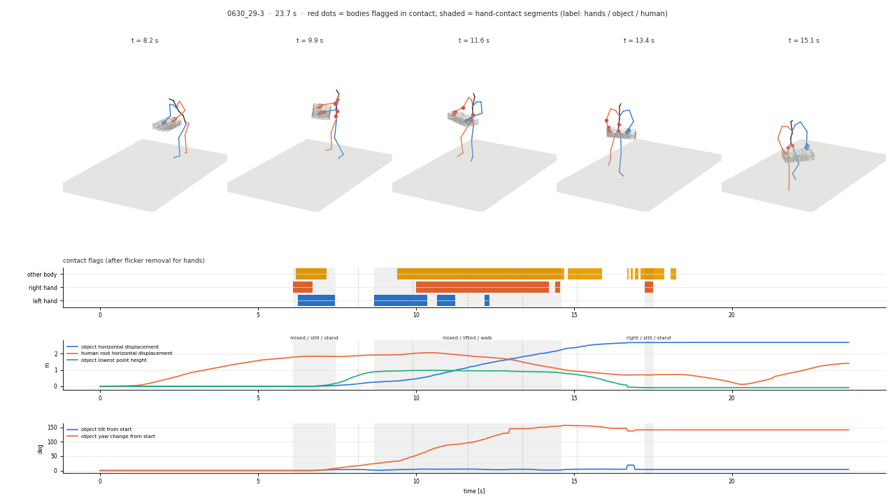

### plasticcontainer #2: both / lifted (33 % of its clips) — `0630_13-2`

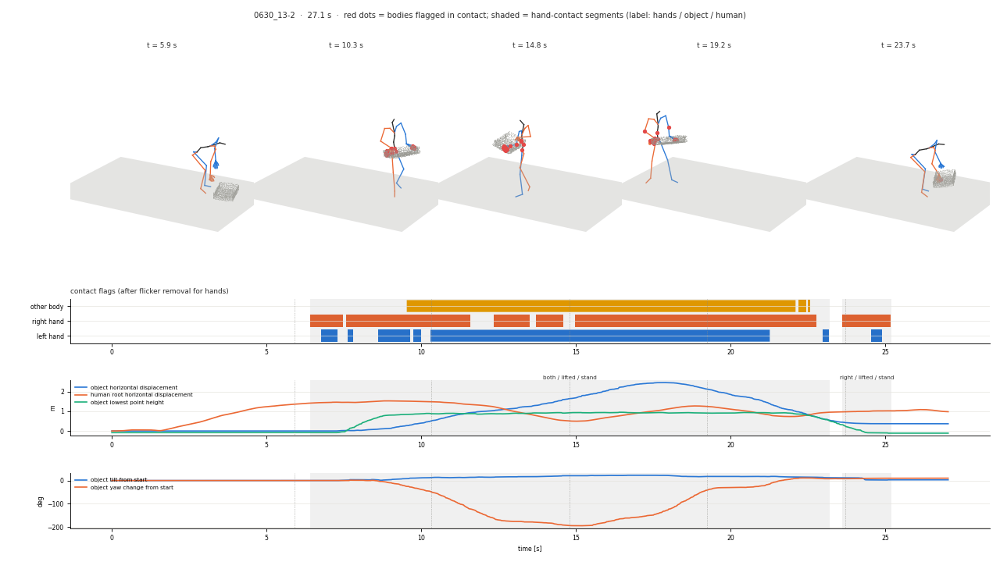

### box_huge #1: both / slid (28 % of its clips) — `260923_09_1_1`

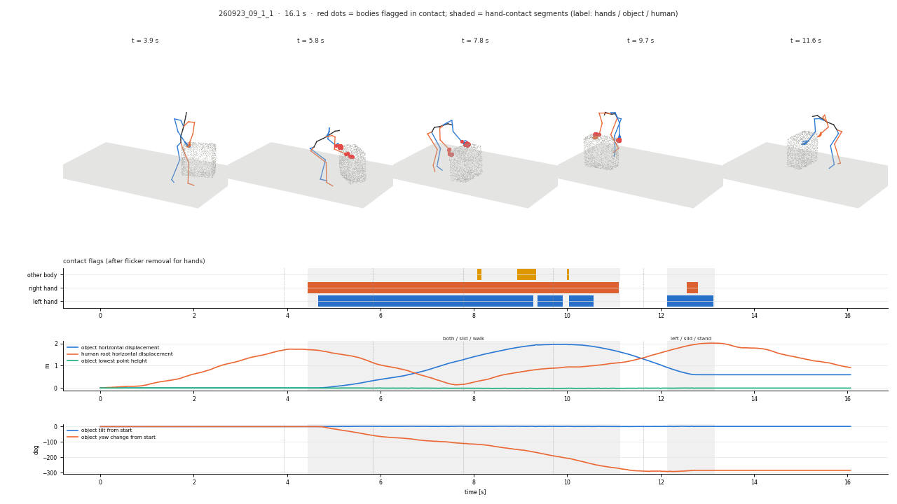

### box_huge #2: mixed / slid (26 % of its clips) — `260923_03_2_1`

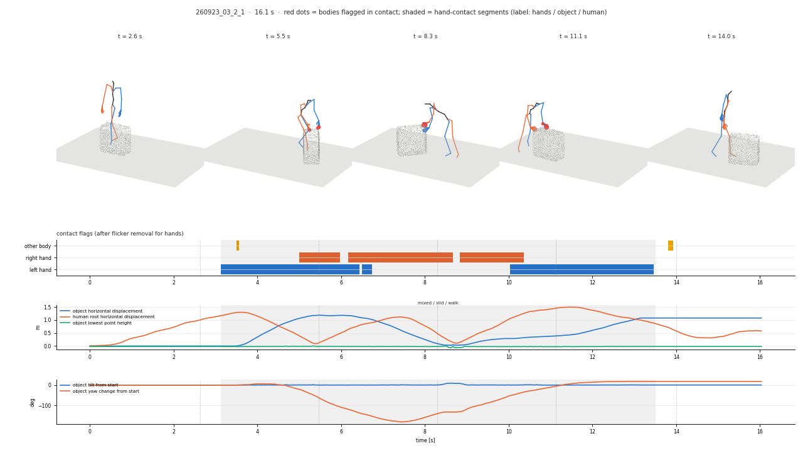

### laundrybasket #1: right / lifted (37 % of its clips) — `040723_16_3_1`

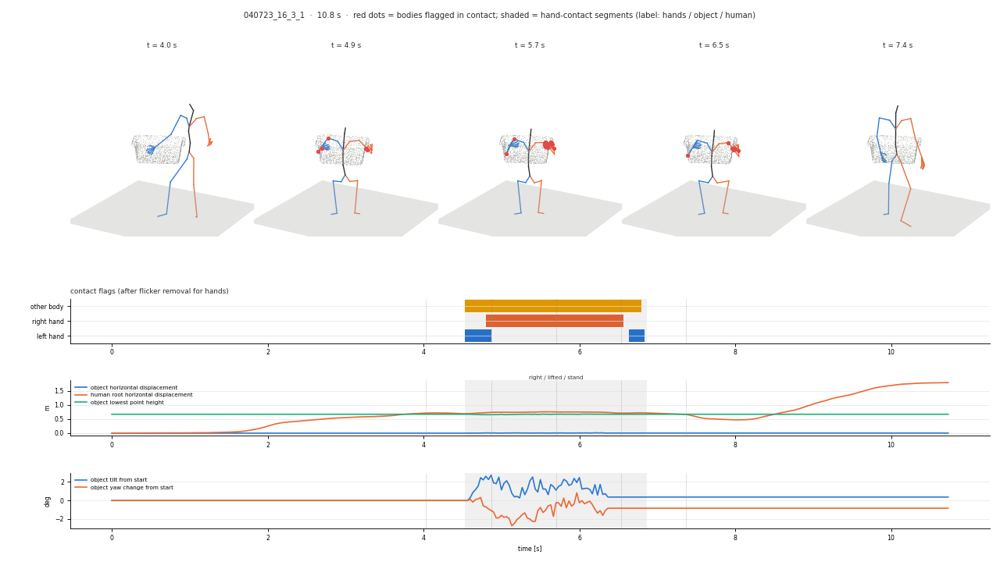

### laundrybasket #2: left / still (23 % of its clips) — `040723_16_1_1`

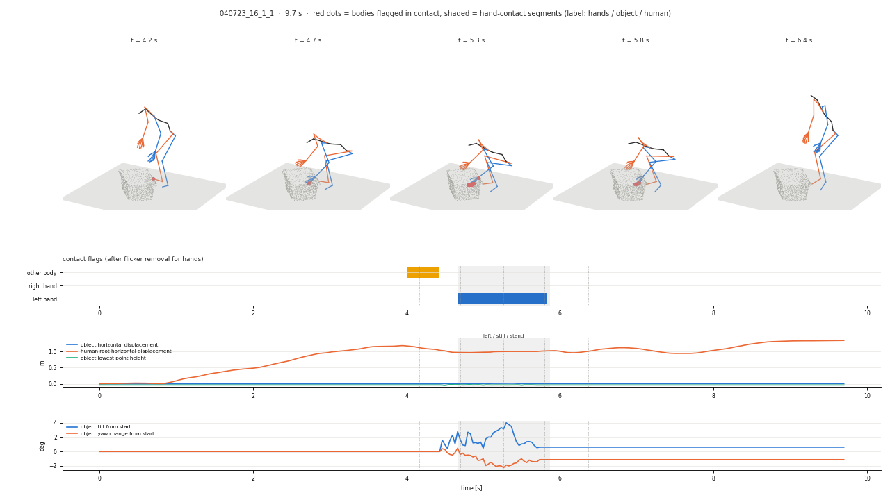

### backpack #1: left / lifted (58 % of its clips) — `0630_20-2`

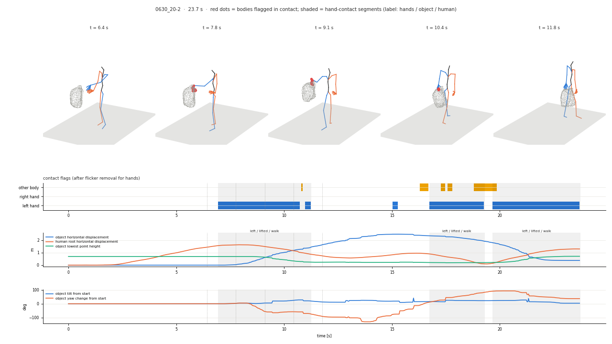

### backpack #2: right / lifted (33 % of its clips) — `0630_19-2`

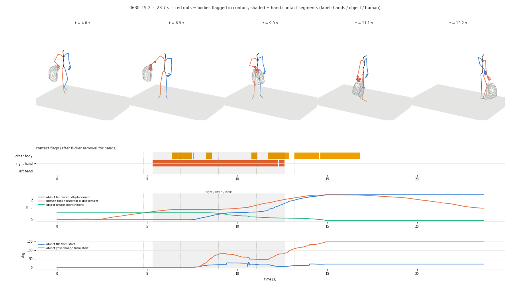

## Label thresholds

```
{"min_run_s": 0.2, "max_gap_s": 0.3, "min_seg_s": 0.3, "lift_m": 0.05, "lift_frac": 0.3, "tilt_deg": 15.0, "slide_m": 0.1, "yaw_deg": 20.0, "walk_m": 0.5}
```
