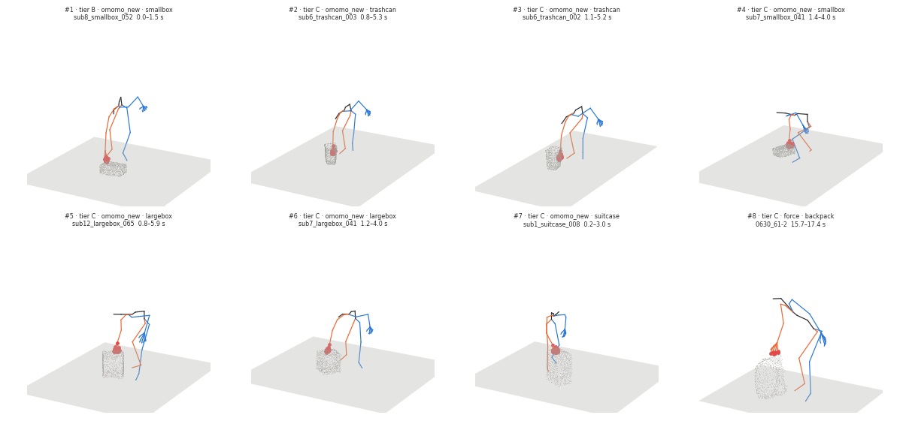

# Push candidates (spec learned v0.5 §7.1 step 1)

Run `R005_push_candidates` · code `v0.1.3-1-g01985ab` (dirty=False) · omomo_new 4421 files, 4270 segments · force 398 files, 696 segments · 0 errors · 6.5 min

**Checks: PASS** — all_files_processed: pass, enough_candidates: pass, contact_proxy_on_surface: pass, force_data_pinned: pass

## Criteria (in order) and how many segments are left

| criterion | rule | meaning | omomo_new | force |
|---|---|---|---|---|
| all segments | | | 4270 | 696 |
| slid | `object_state == slid` | object slides on the floor (moves >= 0.10 m, not lifted or tilted) | 1037 | 146 |
| on_floor | `obj_lifted_frac <= 0.1` | object lowest point > 5 cm in at most 10 % of the frames | 1022 | 145 |
| right_hand | `hands == right` | right hand only in >= 60 % of the contact frames | 276 | 25 |
| long_enough | `duration_s >= 1.0` | contact lasts at least 1 s | 263 | 17 |
| small_tilt | `obj_tilt_max_deg < 10.0` | object tilts less than 10 deg | 236 | 16 |
| small_yaw | `obj_yaw_maxabs_deg < 20.0` | object turns less than 20 deg about z | 83 | 3 |
| hand_only | `frac_body < 0.05` | other body parts touch in < 5 % of the frames | 76 | 3 |
| on_surface | `contact_surface_dist_median_m <= 0.08` | hand contact proxy within 8 cm of the surface | 76 | 3 |
| push | `push_alignment >= 0.7` | object moves away from the hand (cos >= 0.7; pull is negative) | 51 | 2 |
| one_face | `normal_spread_p90_deg <= 20.0` | contact stays on one face (normal spread p90 <= 20 deg) | 17 | 1 |
| flat_patch | `patch_coherence_median >= 0.8` | contact patch is flat (no edge / corner) | 10 | 1 |

Ranking: tier (A = approach and retreat observed and within 30° of the normal; B = within, but one is not observable; C = sideways), then a vertical face (tilt ≤ 30°), then duration × displacement; at most 2 per object, one per clip.

## Candidates

| # | tier | dataset / object | clip | segment [s] | moves [m] | push | spread p90 [°] | face tilt [°] | approach / retreat [°] | contact z [m] | figure |
|---|---|---|---|---|---|---|---|---|---|---|---|
| 1 | B | omomo_new / smallbox | sub8_smallbox_052 | 0.0–1.5 | 1.50 | 0.99 | 15.2 | 83.3 | – / 15.1 | 0.18 | [png](candidates/01_sub8_smallbox_052.png) |
| 2 | C | omomo_new / trashcan | sub6_trashcan_003 | 0.8–5.3 | 2.23 | 0.94 | 7.6 | 4.8 | 74.3 / 45.3 | 0.14 | [png](candidates/02_sub6_trashcan_003.png) |
| 3 | C | omomo_new / trashcan | sub6_trashcan_002 | 1.1–5.2 | 1.60 | 0.99 | 2.2 | 3.0 | 72.4 / 50.4 | 0.13 | [png](candidates/03_sub6_trashcan_002.png) |
| 4 | C | omomo_new / smallbox | sub7_smallbox_041 | 1.4–4.0 | 1.83 | 0.96 | 2.0 | 84.1 | 30.8 / 24.5 | 0.17 | [png](candidates/04_sub7_smallbox_041.png) |
| 5 | C | omomo_new / largebox | sub12_largebox_065 | 0.8–5.9 | 0.94 | 0.94 | 3.8 | 88.0 | 19.7 / 64.8 | 0.37 | [png](candidates/05_sub12_largebox_065.png) |
| 6 | C | omomo_new / largebox | sub7_largebox_041 | 1.2–4.0 | 1.60 | 0.98 | 2.9 | 87.4 | 42.3 / 31.6 | 0.36 | [png](candidates/06_sub7_largebox_041.png) |
| 7 | C | omomo_new / suitcase | sub1_suitcase_008 | 0.2–3.0 | 1.53 | 0.98 | 1.4 | 84.3 | 126.2 / 130.9 | 0.53 | [png](candidates/07_sub1_suitcase_008.png) |
| 8 | C | force / backpack | 0630_61-2 | 15.7–17.4 | 0.19 | 0.99 | 17.2 | 57.0 | 127.9 / 57.6 | 0.49 | [png](candidates/08_0630_61-2.png) |

## Slid segments per object (passed / slid, most common first failure)

| dataset / object | slid | passed | first failure |
|---|---|---|---|
| omomo_new/clothesstand | 23 | 0 | right_hand 14, small_yaw 4, on_floor 2, push 1 |
| omomo_new/floorlamp | 73 | 0 | right_hand 35, small_yaw 17, on_floor 7, push 6 |
| omomo_new/largebox | 126 | 2 | right_hand 94, small_yaw 17, one_face 8, long_enough 3 |
| omomo_new/largetable | 124 | 0 | right_hand 110, small_yaw 7, small_tilt 3, one_face 2 |
| omomo_new/monitor | 7 | 0 | right_hand 4, small_yaw 1, push 1, small_tilt 1 |
| omomo_new/plasticbox | 114 | 0 | right_hand 85, small_yaw 12, one_face 7, small_tilt 5 |
| omomo_new/smallbox | 132 | 4 | right_hand 84, small_yaw 29, one_face 7, flat_patch 6 |
| omomo_new/smalltable | 123 | 0 | right_hand 97, small_yaw 16, push 3, one_face 2 |
| omomo_new/suitcase | 115 | 1 | right_hand 88, small_yaw 14, one_face 8, push 3 |
| omomo_new/trashcan | 65 | 3 | right_hand 36, small_yaw 14, push 6, small_tilt 6 |
| omomo_new/tripod | 7 | 0 | right_hand 4, on_floor 2, long_enough 1 |
| omomo_new/whitechair | 74 | 0 | right_hand 50, small_yaw 20, small_tilt 3, push 1 |
| omomo_new/woodchair | 54 | 0 | right_hand 45, small_tilt 3, long_enough 2, on_floor 2 |
| force/backpack | 3 | 1 | small_tilt 1, one_face 1 |
| force/box_huge | 56 | 0 | right_hand 41, small_yaw 9, long_enough 5, push 1 |
| force/chair | 86 | 0 | right_hand 79, small_yaw 4, long_enough 3 |
| force/plasticcontainer | 1 | 0 | on_floor 1 |
