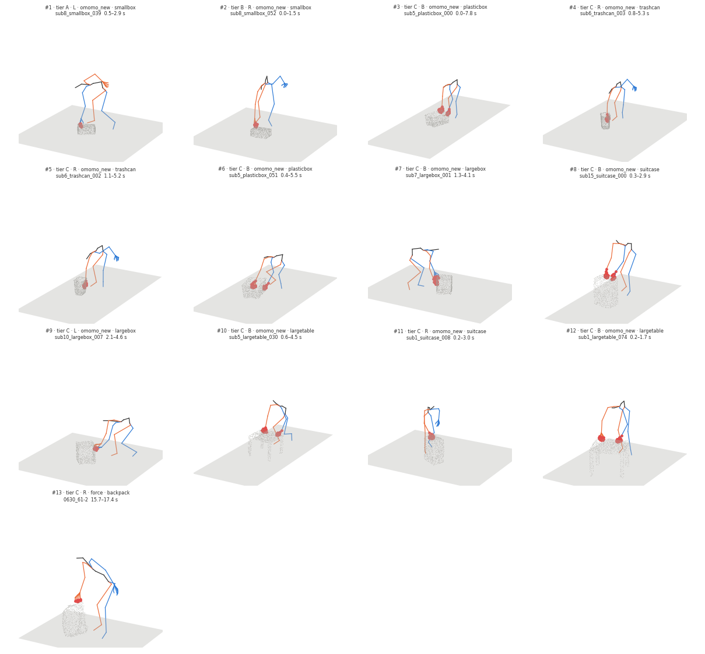

# Push candidates (spec learned v0.6 §7.1 step 1)

Run `R007_candidates` · code `v0.1.3-6-g04e7eab` (dirty=False) · omomo_new 4421 files, 4270 segments · force 398 files, 696 segments · 0 errors · 7.2 min

**Checks: PASS** — all_files_processed: pass, enough_candidates: pass, contact_proxy_on_surface: pass, force_data_pinned: pass

## Criteria (in order) and how many segments are left

| criterion | rule | meaning | omomo_new | force |
|---|---|---|---|---|
| all segments | | | 4270 | 696 |
| slid | `object_state == slid` | object slides on the floor (moves >= 0.10 m, not lifted or tilted) | 1037 | 146 |
| on_floor | `obj_lifted_frac <= 0.1` | object lowest point > 5 cm in at most 10 % of the frames | 1022 | 145 |
| one_mode | `hands in ('left', 'right', 'both')` | one hand, or both hands together, in >= 60 % of the contact frames (no switching) | 936 | 108 |
| long_enough | `duration_s >= 1.0` | contact lasts at least 1 s | 899 | 97 |
| small_tilt | `obj_tilt_max_deg < 10.0` | object tilts less than 10 deg | 791 | 95 |
| small_yaw | `obj_yaw_maxabs_deg < 20.0` | object turns less than 20 deg about z | 268 | 10 |
| hand_only | `frac_body < 0.05` | other body parts touch in < 5 % of the frames | 247 | 9 |
| same_face | `hands_face_angle_deg <= 30.0` | both hands on the same face (0 for one hand; squeeze fails) | 160 | 5 |
| on_surface | `contact_surface_dist_median_m <= 0.08` | hand contact proxy within 8 cm of the surface | 159 | 5 |
| push | `push_alignment >= 0.7` | object moves away from the hand (cos >= 0.7; pull is negative) | 112 | 2 |
| one_face | `normal_spread_p90_deg <= 20.0` | contact stays on one face (normal spread p90 <= 20 deg) | 50 | 1 |
| flat_patch | `patch_coherence_median >= 0.8` | contact patch is flat (no edge / corner) | 36 | 1 |

Ranking: tier (A = approach and retreat observed and within 30° of the normal; B = within, but one is not observable; C = sideways), then a vertical face (tilt ≤ 30°), then duration × displacement; at most 2 per object, one per clip.

Passing segments by virtual-hand mode (R = right hand, L = left hand, B = both hands on one face): B 14, L 12, R 11

## Candidates

| # | tier | mode | dataset / object | clip | segment [s] | moves [m] | push | spread p90 [°] | face tilt [°] | approach / retreat [°] | contact z [m] | figure |
|---|---|---|---|---|---|---|---|---|---|---|---|---|
| 1 | A | L | omomo_new / smallbox | sub8_smallbox_039 | 0.5–2.9 | 1.41 | 0.97 | 10.5 | 81.2 | 27.1 / 5.2 | 0.18 | [png](candidates/01_sub8_smallbox_039.png) |
| 2 | B | R | omomo_new / smallbox | sub8_smallbox_052 | 0.0–1.5 | 1.50 | 0.99 | 15.2 | 83.3 | – / 15.1 | 0.18 | [png](candidates/02_sub8_smallbox_052.png) |
| 3 | C | B | omomo_new / plasticbox | sub5_plasticbox_000 | 0.0–7.8 | 2.53 | 1.00 | 6.7 | 6.8 | – / 118.2 | 0.27 | [png](candidates/03_sub5_plasticbox_000.png) |
| 4 | C | R | omomo_new / trashcan | sub6_trashcan_003 | 0.8–5.3 | 2.23 | 0.94 | 7.6 | 4.8 | 74.3 / 45.3 | 0.14 | [png](candidates/04_sub6_trashcan_003.png) |
| 5 | C | R | omomo_new / trashcan | sub6_trashcan_002 | 1.1–5.2 | 1.60 | 0.99 | 2.2 | 3.0 | 72.4 / 50.4 | 0.13 | [png](candidates/05_sub6_trashcan_002.png) |
| 6 | C | B | omomo_new / plasticbox | sub5_plasticbox_051 | 0.4–5.5 | 1.22 | 0.99 | 2.0 | 3.3 | 59.0 / 76.6 | 0.10 | [png](candidates/06_sub5_plasticbox_051.png) |
| 7 | C | B | omomo_new / largebox | sub7_largebox_001 | 1.3–4.1 | 1.85 | 0.95 | 1.9 | 4.2 | 78.3 / 52.1 | 0.28 | [png](candidates/07_sub7_largebox_001.png) |
| 8 | C | B | omomo_new / suitcase | sub15_suitcase_000 | 0.3–2.9 | 1.08 | 0.95 | 5.8 | 23.7 | 32.9 / 31.1 | 0.51 | [png](candidates/08_sub15_suitcase_000.png) |
| 9 | C | L | omomo_new / largebox | sub10_largebox_007 | 2.1–4.6 | 0.91 | 0.91 | 0.3 | 2.7 | 37.5 / 40.8 | 0.28 | [png](candidates/09_sub10_largebox_007.png) |
| 10 | C | B | omomo_new / largetable | sub5_largetable_030 | 0.6–4.5 | 1.63 | 1.00 | 2.9 | 87.3 | 133.8 / 139.6 | 0.46 | [png](candidates/10_sub5_largetable_030.png) |
| 11 | C | R | omomo_new / suitcase | sub1_suitcase_008 | 0.2–3.0 | 1.53 | 0.98 | 1.4 | 84.3 | 126.2 / 130.9 | 0.53 | [png](candidates/11_sub1_suitcase_008.png) |
| 12 | C | B | omomo_new / largetable | sub1_largetable_074 | 0.2–1.7 | 0.27 | 0.95 | 6.6 | 82.9 | 13.4 / 100.5 | 0.48 | [png](candidates/12_sub1_largetable_074.png) |
| 13 | C | R | force / backpack | 0630_61-2 | 15.7–17.4 | 0.19 | 0.99 | 17.2 | 57.0 | 127.9 / 57.6 | 0.49 | [png](candidates/13_0630_61-2.png) |

## Slid segments per object (passed / slid, most common first failure)

| dataset / object | slid | passed | first failure |
|---|---|---|---|
| omomo_new/clothesstand | 23 | 0 | small_yaw 14, small_tilt 3, on_floor 2, long_enough 2 |
| omomo_new/floorlamp | 73 | 0 | small_yaw 41, hand_only 8, push 7, on_floor 7 |
| omomo_new/largebox | 126 | 9 | small_yaw 64, one_mode 21, one_face 14, long_enough 9 |
| omomo_new/largetable | 124 | 3 | small_yaw 58, small_tilt 28, same_face 16, one_mode 9 |
| omomo_new/monitor | 7 | 0 | small_yaw 3, small_tilt 3, push 1 |
| omomo_new/plasticbox | 114 | 5 | small_yaw 39, small_tilt 16, same_face 13, one_face 12 |
| omomo_new/smallbox | 132 | 12 | small_yaw 62, same_face 14, one_face 14, one_mode 10 |
| omomo_new/smalltable | 123 | 0 | small_yaw 68, small_tilt 13, same_face 10, one_mode 9 |
| omomo_new/suitcase | 115 | 2 | small_yaw 77, same_face 10, one_face 9, one_mode 9 |
| omomo_new/trashcan | 65 | 5 | small_yaw 31, small_tilt 14, push 8, same_face 6 |
| omomo_new/tripod | 7 | 0 | small_tilt 3, on_floor 2, same_face 1, long_enough 1 |
| omomo_new/whitechair | 74 | 0 | small_yaw 47, small_tilt 9, one_mode 7, same_face 5 |
| omomo_new/woodchair | 54 | 0 | small_yaw 19, small_tilt 12, same_face 7, hand_only 7 |
| force/backpack | 3 | 1 | small_tilt 1, one_face 1 |
| force/box_huge | 56 | 0 | small_yaw 30, one_mode 16, long_enough 7, push 2 |
| force/chair | 86 | 0 | small_yaw 55, one_mode 21, long_enough 4, same_face 3 |
| force/plasticcontainer | 1 | 0 | on_floor 1 |
