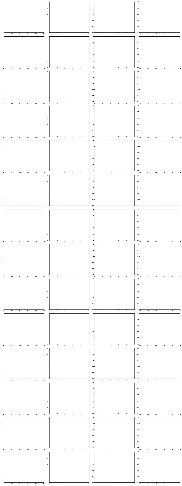

# D0 chain: OMOMO_new -> GMR -> G1 -> X-Morph -> B2-Z1

Run `R007_d0` · code `v0.1.3-6-g04e7eab` (dirty=False) · device `cuda:0`

| clip | frames | longest contact (hands, object, s) | wrist err median L/R [m] | hand height in contact [m] | Z1 site height (prior) in contact [m] | path G1/B2 [m] | turn G1/B2 [deg] | pass |
|---|---|---|---|---|---|---|---|---|
| sub10_largebox_007 | error (see summary.json) | | | | | | | False |
| sub15_suitcase_000 | error (see summary.json) | | | | | | | False |
| sub1_largetable_074 | error (see summary.json) | | | | | | | False |
| sub1_suitcase_008 | error (see summary.json) | | | | | | | False |
| sub5_largetable_030 | error (see summary.json) | | | | | | | False |
| sub5_plasticbox_000 | error (see summary.json) | | | | | | | False |
| sub5_plasticbox_051 | error (see summary.json) | | | | | | | False |
| sub6_trashcan_002 | error (see summary.json) | | | | | | | False |
| sub6_trashcan_003 | error (see summary.json) | | | | | | | False |
| sub7_largebox_001 | error (see summary.json) | | | | | | | False |
| sub7_largebox_041 | error (see summary.json) | | | | | | | False |
| sub7_smallbox_041 | error (see summary.json) | | | | | | | False |
| sub8_smallbox_039 | error (see summary.json) | | | | | | | False |
| sub8_smallbox_052 | error (see summary.json) | | | | | | | False |

