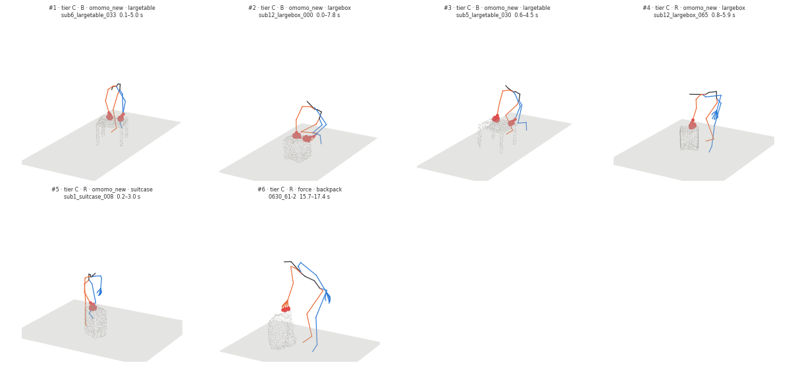

# Push candidates (spec learned v0.6 §7.1 step 1)

Run `R010_candidates` · code `v0.1.3-11-gf6899c2` (dirty=False) · omomo_new 4421 files, 4270 segments · force 398 files, 696 segments · 0 errors · 6.7 min

**Checks: PASS** — all_files_processed: pass, enough_candidates: pass, contact_proxy_on_surface: pass, force_data_pinned: pass

## Criteria (in order) and how many segments are left

| criterion | rule | meaning | omomo_new | force |
|---|---|---|---|---|
| all segments | | | 4270 | 696 |
| slid | `object_state == slid` | object slides on the floor (moves >= 0.10 m, not lifted or tilted) | 1037 | 146 |
| on_floor | `obj_lifted_frac <= 0.1` | object lowest point > 5 cm in at most 10 % of the frames | 1022 | 145 |
| one_mode | `hands in ('left', 'right', 'both')` | one hand, or both hands together, in >= 60 % of the contact frames (no switching) | 936 | 108 |
| long_enough | `duration_s >= 1.0` | contact lasts at least 1 s | 899 | 97 |
| small_tilt | `obj_tilt_max_deg < 10.0` | object tilts less than 10 deg | 791 | 95 |
| small_yaw | `obj_yaw_maxabs_deg < 45.0` | object turns less than 45 deg about z | 469 | 15 |
| hand_only | `frac_body < 0.05` | other body parts touch in < 5 % of the frames | 436 | 14 |
| same_face | `hands_face_angle_deg <= 30.0` | both hands on the same face (0 for one hand; squeeze fails) | 282 | 7 |
| on_surface | `contact_surface_dist_median_m <= 0.08` | hand contact proxy within 8 cm of the surface | 281 | 7 |
| push | `push_alignment >= 0.7` | object moves away from the hand (cos >= 0.7; pull is negative) | 181 | 3 |
| one_face | `normal_spread_p90_deg <= 20.0` | contact stays on one face (normal spread p90 <= 20 deg) | 77 | 1 |
| flat_patch | `patch_coherence_median >= 0.8` | contact patch is flat (no edge / corner) | 56 | 1 |
| reach_band | `in_reach_band == True` | contact height within the arm's band (side 0.5-1.2 m, top 0.3-0.8 m, slant 0.4-1.2 m) | 11 | 1 |

Ranking: tier (A = approach and retreat observed and within 30° of the normal; B = within, but one is not observable; C = sideways), then a vertical face (tilt ≤ 30°), then duration × displacement; at most 2 per object, one per clip.

Passing segments by virtual-hand mode (R = right hand, L = left hand, B = both hands on one face): B 6, L 2, R 4

## Candidates

| # | tier | mode | dataset / object | clip | segment [s] | moves [m] | push | spread p90 [°] | face tilt [°] | approach / retreat [°] | contact z [m] | figure |
|---|---|---|---|---|---|---|---|---|---|---|---|---|
| 1 | C | B | omomo_new / largetable | sub6_largetable_033 | 0.1–5.0 | 2.01 | 0.94 | 0.7 | 89.2 | – / 147.7 | 0.46 | [png](candidates/01_sub6_largetable_033.png) |
| 2 | C | B | omomo_new / largebox | sub12_largebox_000 | 0.0–7.8 | 0.83 | 0.97 | 1.4 | 86.3 | – / 145.1 | 0.34 | [png](candidates/02_sub12_largebox_000.png) |
| 3 | C | B | omomo_new / largetable | sub5_largetable_030 | 0.6–4.5 | 1.63 | 1.00 | 2.9 | 87.3 | 133.8 / 139.6 | 0.46 | [png](candidates/03_sub5_largetable_030.png) |
| 4 | C | R | omomo_new / largebox | sub12_largebox_065 | 0.8–5.9 | 0.94 | 0.94 | 3.8 | 88.0 | 19.7 / 64.8 | 0.37 | [png](candidates/04_sub12_largebox_065.png) |
| 5 | C | R | omomo_new / suitcase | sub1_suitcase_008 | 0.2–3.0 | 1.53 | 0.98 | 1.4 | 84.3 | 126.2 / 130.9 | 0.53 | [png](candidates/05_sub1_suitcase_008.png) |
| 6 | C | R | force / backpack | 0630_61-2 | 15.7–17.4 | 0.19 | 0.99 | 17.2 | 57.0 | 127.9 / 57.6 | 0.49 | [png](candidates/06_0630_61-2.png) |

## Slid segments per object (passed / slid, most common first failure)

| dataset / object | slid | passed | first failure |
|---|---|---|---|
| omomo_new/clothesstand | 23 | 0 | small_yaw 8, push 4, small_tilt 3, on_floor 2 |
| omomo_new/floorlamp | 73 | 0 | small_yaw 27, push 15, hand_only 10, on_floor 7 |
| omomo_new/largebox | 126 | 6 | small_yaw 41, one_face 22, one_mode 21, same_face 16 |
| omomo_new/largetable | 124 | 4 | small_yaw 32, same_face 32, small_tilt 28, push 12 |
| omomo_new/monitor | 7 | 0 | small_tilt 3, push 2, small_yaw 2 |
| omomo_new/plasticbox | 114 | 0 | small_yaw 23, one_face 18, same_face 17, small_tilt 16 |
| omomo_new/smallbox | 132 | 0 | small_yaw 31, one_face 26, reach_band 25, same_face 15 |
| omomo_new/smalltable | 123 | 0 | small_yaw 46, same_face 18, push 15, small_tilt 13 |
| omomo_new/suitcase | 115 | 1 | small_yaw 52, same_face 24, one_face 13, push 9 |
| omomo_new/trashcan | 65 | 0 | push 21, small_tilt 14, small_yaw 11, same_face 8 |
| omomo_new/tripod | 7 | 0 | small_tilt 3, on_floor 2, same_face 1, long_enough 1 |
| omomo_new/whitechair | 74 | 0 | small_yaw 36, same_face 10, small_tilt 9, one_mode 7 |
| omomo_new/woodchair | 54 | 0 | small_yaw 13, small_tilt 12, hand_only 9, same_face 9 |
| force/backpack | 3 | 1 | small_tilt 1, one_face 1 |
| force/box_huge | 56 | 0 | small_yaw 25, one_mode 16, long_enough 7, same_face 4 |
| force/chair | 86 | 0 | small_yaw 55, one_mode 21, long_enough 4, same_face 3 |
| force/plasticcontainer | 1 | 0 | on_floor 1 |
