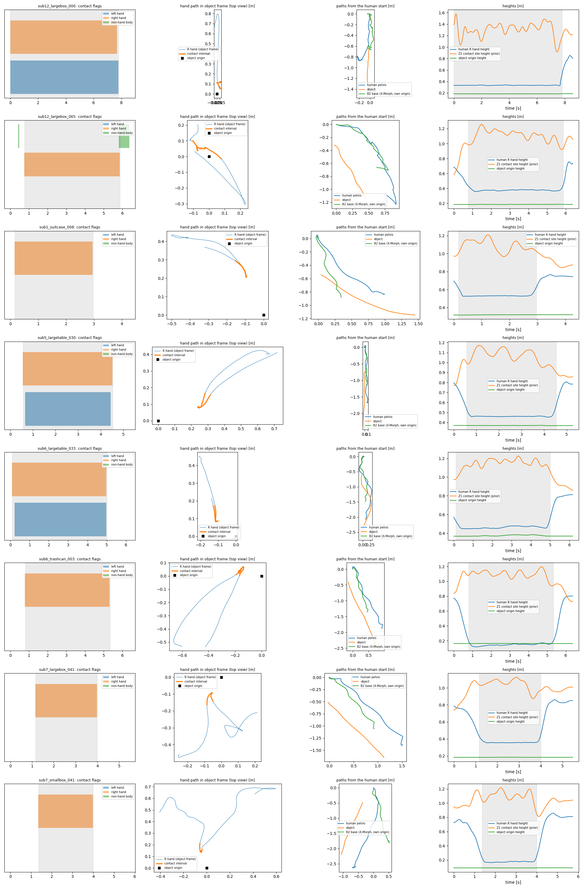

# D0 chain: OMOMO_new -> GMR -> G1 -> X-Morph -> B2-Z1

Run `R010_d0` · code `v0.1.3-11-gf6899c2` (dirty=False) · device `cuda:0`

| clip | frames | longest contact (hands, object, s) | wrist err median L/R [m] | hand height in contact [m] | Z1 site height (prior) in contact [m] | path G1/B2 [m] | turn G1/B2 [deg] | pass |
|---|---|---|---|---|---|---|---|---|
| sub12_largebox_000 | 258 | both, slid, 7.8 | 0.036 / 0.035 | 0.33–0.48 | 0.91–1.58 | 1.15 / 1.17 | 6 / 12 | True |
| sub12_largebox_065 | 192 | right, slid, 5.1 | 0.029 / 0.043 | 0.36–0.44 | 0.92–1.26 | 1.71 / 1.39 | -55 / -26 | True |
| sub1_suitcase_008 | 129 | right, slid, 2.8 | 0.062 / 0.076 | 0.52–0.62 | 0.97–1.21 | 1.25 / 1.09 | 77 / 37 | True |
| sub5_largetable_030 | 159 | both, slid, 4.0 | 0.040 / 0.041 | 0.45–0.54 | 0.91–1.17 | 1.61 / 1.32 | -6 / -1 | True |
| sub6_largetable_033 | 186 | both, slid, 4.9 | 0.031 / 0.033 | 0.45–0.54 | 0.98–1.23 | 1.99 / 1.69 | -11 / -2 | True |
| sub6_trashcan_003 | 192 | right, slid, 4.5 | 0.027 / 0.030 | 0.12–0.19 | 0.94–1.20 | 2.00 / 1.61 | -6 / -1 | True |
| sub7_largebox_041 | 165 | right, slid, 2.8 | 0.066 / 0.064 | 0.35–0.43 | 0.87–1.13 | 1.88 / 1.54 | -3 / -0 | True |
| sub7_smallbox_041 | 173 | right, slid, 2.6 | 0.064 / 0.065 | 0.16–0.23 | 0.87–1.22 | 2.53 / 2.07 | -155 / -79 | True |

