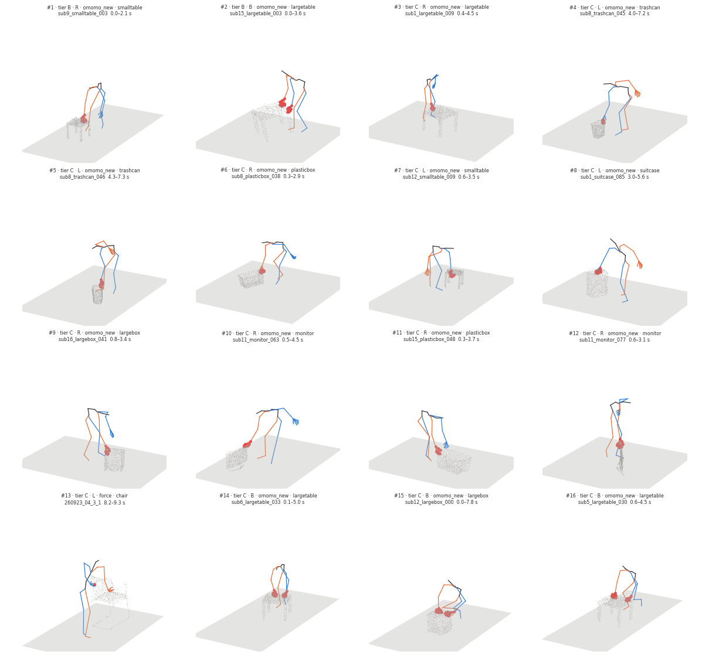

# Push candidates (spec learned v0.6 §7.1 step 1)

Run `R013_candidates` · code `v0.1.3-14-gfa9ae09` (dirty=False) · omomo_new 4421 files, 4270 segments · force 398 files, 696 segments · 0 errors · 8.0 min

**Checks: PASS** — all_files_processed: pass, enough_candidates: pass, contact_proxy_on_surface: pass, force_data_pinned: pass

## Criteria (in order) and how many segments are left

| criterion | rule | meaning | omomo_new | force |
|---|---|---|---|---|
| all segments | | | 4270 | 696 |
| slid | `object_state == slid` | object slides on the floor (moves >= 0.10 m, not lifted or tilted) | 1037 | 146 |
| on_floor | `obj_lifted_frac <= 0.1` | object lowest point > 5 cm in at most 10 % of the frames | 1022 | 145 |
| one_mode | `hands in ('left', 'right', 'both')` | one hand, or both hands together, in >= 60 % of the contact frames (no switching) | 936 | 108 |
| long_enough | `duration_s >= 1.0` | contact lasts at least 1 s | 899 | 97 |
| small_tilt | `obj_tilt_max_deg < 10.0` | object tilts less than 10 deg | 791 | 95 |
| small_yaw | `obj_yaw_maxabs_deg < 45.0` | object turns less than 45 deg about z | 469 | 15 |
| hand_only | `frac_body < 0.05` | other body parts touch in < 5 % of the frames | 436 | 14 |
| same_face | `hands_face_angle_deg <= 30.0` | both hands on the same face (0 for one hand; squeeze fails) | 282 | 7 |
| on_surface | `contact_surface_dist_median_m <= 0.08` | hand contact proxy within 8 cm of the surface | 281 | 7 |
| interaction | `interaction in ('push', 'pull')` | object moves away from (push) or towards (pull) the hand, abs(cos) >= 0.7: push/pull | 247 | 5 |
| contact_shape | `contact_shape_ok == True` | one flat face (press), or a grasp | 117 | 3 |
| reach_band | `in_reach_band == True` | contact height within the arm's band (side 0.5-1.2 m, top 0.3-0.8 m, slant 0.4-1.2 m, grasp 0.3-1.2 m) | 64 | 3 |

Ranking: tier (A = approach and retreat observed and within 30° of the normal; B = within, but one is not observable; C = sideways), then a vertical face (tilt ≤ 30°), then duration × displacement; at most 2 per object, one per clip.

Passing segments by virtual-hand mode (R = right hand, L = left hand, B = both hands on one face): B 8, L 27, R 32

Passing segments by interaction / grip: force/pull/grasp 2, force/push/press 1, omomo_new/pull/grasp 53, omomo_new/push/press 11

Finger motion (median std of fingertips in the wrist frame; ~0 = fixed hand shape): omomo_new 0.0 mm, force 0.7 mm

## Candidates

| # | tier | mode | interaction / grip | dataset / object | clip | segment [s] | moves [m] | push | spread p90 [°] | face tilt [°] | approach / retreat [°] | contact z [m] | figure |
|---|---|---|---|---|---|---|---|---|---|---|---|---|---|
| 1 | B | R | pull / grasp | omomo_new / smalltable | sub9_smalltable_003 | 0.0–2.1 | 1.40 | -0.98 | 47.5 | 3.0 | – / – | 0.33 | [png](candidates/01_sub9_smalltable_003.png) |
| 2 | B | B | pull / grasp | omomo_new / largetable | sub15_largetable_003 | 0.0–3.6 | 0.75 | -0.78 | 44.6 | 10.4 | – / – | 0.51 | [png](candidates/02_sub15_largetable_003.png) |
| 3 | C | R | pull / grasp | omomo_new / largetable | sub1_largetable_009 | 0.4–4.5 | 1.73 | -1.00 | 24.9 | 11.7 | 34.4 / 83.4 | 0.47 | [png](candidates/03_sub1_largetable_009.png) |
| 4 | C | L | pull / grasp | omomo_new / trashcan | sub8_trashcan_045 | 4.0–7.2 | 1.67 | -0.98 | 24.9 | 2.7 | 127.7 / 128.6 | 0.33 | [png](candidates/04_sub8_trashcan_045.png) |
| 5 | C | L | pull / grasp | omomo_new / trashcan | sub8_trashcan_046 | 4.3–7.3 | 1.74 | -0.90 | 51.2 | 1.7 | 130.0 / 93.0 | 0.35 | [png](candidates/05_sub8_trashcan_046.png) |
| 6 | C | R | pull / grasp | omomo_new / plasticbox | sub8_plasticbox_038 | 0.3–2.9 | 1.84 | -0.98 | 9.8 | 3.1 | 81.6 / 73.2 | 0.31 | [png](candidates/06_sub8_plasticbox_038.png) |
| 7 | C | L | pull / grasp | omomo_new / smalltable | sub12_smalltable_009 | 0.6–3.5 | 1.55 | -0.93 | 61.7 | 15.1 | 133.9 / 108.0 | 0.34 | [png](candidates/07_sub12_smalltable_009.png) |
| 8 | C | L | pull / grasp | omomo_new / suitcase | sub1_suitcase_085 | 3.0–5.6 | 1.12 | -0.98 | 92.9 | 4.9 | 69.7 / 34.2 | 0.54 | [png](candidates/08_sub1_suitcase_085.png) |
| 9 | C | R | pull / grasp | omomo_new / largebox | sub16_largebox_041 | 0.8–3.4 | 1.09 | -0.95 | 146.8 | 7.3 | 66.4 / 143.5 | 0.32 | [png](candidates/09_sub16_largebox_041.png) |
| 10 | C | R | pull / grasp | omomo_new / monitor | sub11_monitor_063 | 0.5–4.5 | 0.68 | -0.98 | 120.3 | 8.5 | 61.8 / 46.1 | 0.39 | [png](candidates/10_sub11_monitor_063.png) |
| 11 | C | R | pull / grasp | omomo_new / plasticbox | sub15_plasticbox_048 | 0.3–3.7 | 0.64 | -0.92 | 114.3 | 26.3 | 109.0 / – | 0.30 | [png](candidates/11_sub15_plasticbox_048.png) |
| 12 | C | R | pull / grasp | omomo_new / monitor | sub11_monitor_077 | 0.6–3.1 | 0.59 | -0.92 | 9.9 | 1.8 | 103.3 / 58.7 | 0.41 | [png](candidates/12_sub11_monitor_077.png) |
| 13 | C | L | pull / grasp | force / chair | 260923_04_3_1 | 8.2–9.3 | 0.22 | -0.94 | 8.0 | 19.9 | 39.6 / 85.8 | 0.76 | [png](candidates/13_260923_04_3_1.png) |
| 14 | C | B | push / press | omomo_new / largetable | sub6_largetable_033 | 0.1–5.0 | 2.01 | 0.94 | 0.7 | 89.2 | – / 147.7 | 0.46 | [png](candidates/14_sub6_largetable_033.png) |
| 15 | C | B | push / press | omomo_new / largebox | sub12_largebox_000 | 0.0–7.8 | 0.83 | 0.97 | 1.4 | 86.3 | – / 145.1 | 0.34 | [png](candidates/15_sub12_largebox_000.png) |
| 16 | C | B | push / press | omomo_new / largetable | sub5_largetable_030 | 0.6–4.5 | 1.63 | 1.00 | 2.9 | 87.3 | 133.8 / 139.6 | 0.46 | [png](candidates/16_sub5_largetable_030.png) |

## Slid segments per object (passed / slid, most common first failure)

| dataset / object | slid | passed | first failure |
|---|---|---|---|
| omomo_new/clothesstand | 23 | 0 | small_yaw 8, small_tilt 3, interaction 3, on_floor 2 |
| omomo_new/floorlamp | 73 | 0 | small_yaw 27, interaction 15, hand_only 10, on_floor 7 |
| omomo_new/largebox | 126 | 7 | small_yaw 41, contact_shape 24, one_mode 21, same_face 16 |
| omomo_new/largetable | 124 | 14 | small_yaw 32, same_face 32, small_tilt 28, one_mode 9 |
| omomo_new/monitor | 7 | 2 | small_tilt 3, small_yaw 2 |
| omomo_new/plasticbox | 114 | 3 | small_yaw 23, contact_shape 21, same_face 17, small_tilt 16 |
| omomo_new/smallbox | 132 | 0 | contact_shape 37, small_yaw 31, reach_band 26, same_face 15 |
| omomo_new/smalltable | 123 | 13 | small_yaw 46, same_face 18, contact_shape 13, small_tilt 13 |
| omomo_new/suitcase | 115 | 2 | small_yaw 52, same_face 24, contact_shape 16, one_mode 9 |
| omomo_new/trashcan | 65 | 21 | small_tilt 14, small_yaw 11, same_face 8, reach_band 8 |
| omomo_new/tripod | 7 | 0 | small_tilt 3, on_floor 2, same_face 1, long_enough 1 |
| omomo_new/whitechair | 74 | 2 | small_yaw 36, same_face 10, small_tilt 9, one_mode 7 |
| omomo_new/woodchair | 54 | 0 | small_yaw 13, small_tilt 12, hand_only 9, same_face 9 |
| force/backpack | 3 | 1 | small_tilt 1, contact_shape 1 |
| force/box_huge | 56 | 1 | small_yaw 25, one_mode 16, long_enough 7, same_face 4 |
| force/chair | 86 | 1 | small_yaw 55, one_mode 21, long_enough 4, same_face 3 |
| force/plasticcontainer | 1 | 0 | on_floor 1 |
