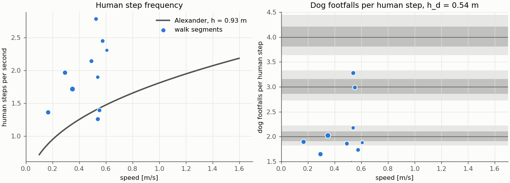
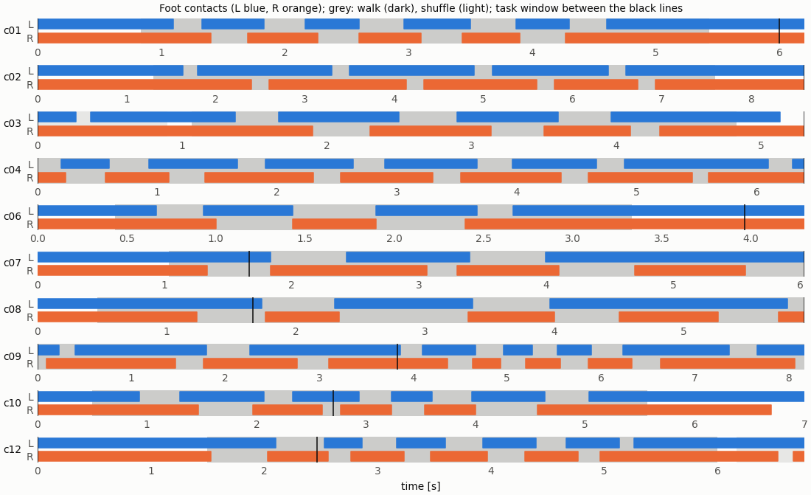

# M0: human gait and the dog's natural rhythm (fullopt spec §6.1-6.3)

Run `R024_fullopt_m0` · code `v0.3.0-3-ga4adfc1` (dirty=False) · 10 tasks · 0 errors · **PASS**

| check | pass |
|---|---|
| all_clips_loaded | True |
| steps_found | True |
| no_double_touchdowns | True |
| feet_alternate | True |
| leg_length_in_range | True |

B2 (home pose): hip height h_d 0.54 m, thigh 0.35 m, calf 0.35 m, longest walk stride 1.05 m. Human leg length h_h (median) 0.93 m; (h_h / h_d)^0.7 = 1.46.

Walk segments: 10 (52.2 s); median speed 0.53 m/s, step frequency 1.93 Hz, dog footfalls per human step 1.88, lock deviation 0.030; 0 would be trot.

| δ | lockable walk segments | lockable walking time | same, inside task windows |
|---|---|---|---|
| 0.05 | 0.20 | 0.25 | 0.25 |
| 0.10 | 0.70 | 0.70 | 0.70 |
| 0.15 | 0.70 | 0.70 | 0.70 |
| 0.20 | 0.80 | 0.79 | 0.79 |

| task | clip | h_h [m] | touchdowns | shortest gap [s] | alternation | walk / shuffle segments | window: steps, walk / shuffle / stand |
|---|---|---|---|---|---|---|---|
| c01_sub6_largetable_033 | sub6_largetable_033 | 0.89 | 9 | 0.33 | 1.00 | 1 / 0 | 9, 0.77 / 0.00 / 0.23 |
| c02_sub12_largebox_000 | sub12_largebox_000 | 1.01 | 8 | 0.33 | 1.00 | 1 / 0 | 8, 0.73 / 0.00 / 0.27 |
| c03_sub5_largetable_030 | sub5_largetable_030 | 0.93 | 7 | 0.33 | 0.83 | 1 / 1 | 7, 0.71 / 0.17 / 0.12 |
| c04_sub12_largebox_065 | sub12_largebox_065 | 0.94 | 13 | 0.30 | 1.00 | 1 / 0 | 13, 1.00 / 0.00 / 0.00 |
| c06_sub1_suitcase_008 | sub1_suitcase_008 | 0.80 | 5 | 0.27 | 1.00 | 1 / 0 | 5, 0.73 / 0.00 / 0.27 |
| c07_sub3_largebox_032 | sub3_largebox_032 | 1.00 | 5 | 0.60 | 1.00 | 1 / 0 | 5, 1.00 / 0.00 / 0.00 |
| c08_sub3_largebox_031 | sub3_largebox_031 | 1.01 | 6 | 0.53 | 0.80 | 1 / 0 | 6, 1.00 / 0.00 / 0.00 |
| c09_sub12_largebox_089 | sub12_largebox_089 | 0.94 | 14 | 0.23 | 1.00 | 1 / 0 | 5, 1.00 / 0.00 / 0.00 |
| c10_sub1_largetable_074 | sub1_largetable_074 | 0.82 | 9 | 0.30 | 1.00 | 1 / 0 | 3, 0.81 / 0.00 / 0.19 |
| c12_sub1_largetable_073 | sub1_largetable_073 | 0.82 | 11 | 0.23 | 1.00 | 1 / 1 | 1, 0.39 / 0.00 / 0.61 |

| task | frames | steps | speed [m/s] | step Hz (Alexander) | dog gait | dog per step | lock dev |
|---|---|---|---|---|---|---|---|
| c01_sub6_largetable_033 | 25–163 | 9 | 0.58 | 2.45 (1.50) | walk | 1.73 | 0.155 |
| c02_sub12_largebox_000 | 39–228 | 8 | 0.17 | 1.36 (0.84) | walk | 1.89 | 0.056 |
| c03_sub5_largetable_030 | 32–145 | 6 | 0.54 | 1.90 (1.42) | walk | 2.17 | -0.080 |
| c04_sub12_largebox_065 | 0–192 | 13 | 0.29 | 1.97 (1.10) | walk | 1.65 | 0.216 |
| c06_sub1_suitcase_008 | 13–100 | 5 | 0.61 | 2.31 (1.65) | walk | 1.88 | 0.066 |
| c07_sub3_largebox_032 | 31–181 | 5 | 0.55 | 1.40 (1.36) | walk | 2.99 | 0.004 |
| c08_sub3_largebox_031 | 14–178 | 6 | 0.54 | 1.26 (1.34) | walk | 3.28 | -0.084 |
| c09_sub12_largebox_089 | 0–245 | 14 | 0.35 | 1.72 (1.18) | walk | 2.02 | -0.010 |
| c10_sub1_largetable_074 | 15–167 | 9 | 0.49 | 2.14 (1.49) | walk | 1.86 | 0.077 |
| c12_sub1_largetable_073 | 45–180 | 10 | 0.53 | 2.78 (1.53) | walk | 1.47 | -0.319 |

Right panel: grey bands are lockable at δ = 0.05 (dark) and 0.10 (light).

