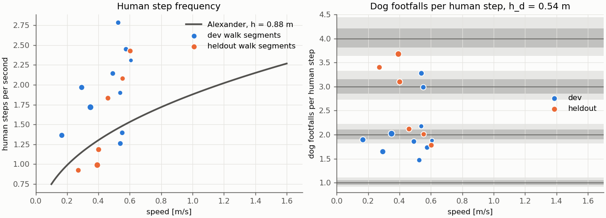
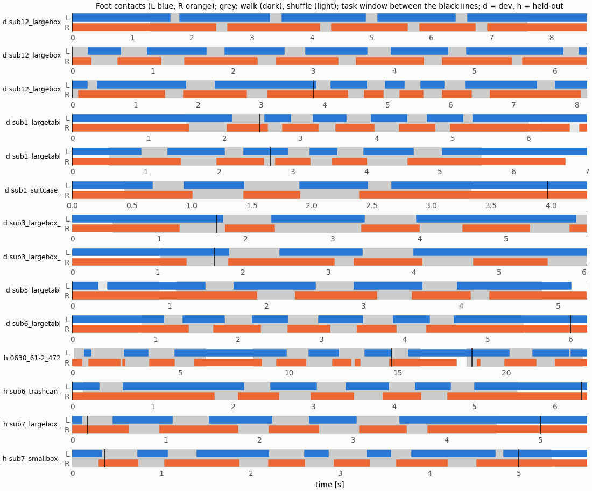

# M0: human gait and the dog's natural rhythm (fullopt spec §6.1-6.3, §8.5)

Run `R027_fullopt_m0` · code `v0.3.2-2-g29c4830` (dirty=False) · 14 clips · **PASS** (decided on dev; held-out reported apart)

| check | dev | heldout |
|---|---|---|
| inputs_valid | True | True |
| steps_found | True | True |
| no_double_touchdowns | True | True |
| feet_alternate | True | False |
| leg_length_in_range | True | True |
| leg_length_same_per_subject | True | True |

Leg length of a subject across both splits (reported): True, sub12 1.4 cm, sub1 2.2 cm, sub3 0.5 cm, sub6 0.3 cm, sub7 0.3 cm.

B2 (home pose): hip height h_d 0.54 m, thigh 0.35 m, calf 0.35 m, longest walk stride 1.05 m.

| split | clips | h_h median [m] | walk segments (s) | speed [m/s] | step Hz | dog per step | lock dev | lockable at δ 0.05 / 0.10 / 0.15 / 0.20 |
|---|---|---|---|---|---|---|---|---|
| dev | 10 | 0.93 | 10 (52.2) | 0.53 | 1.93 | 1.88 | 0.030 | 0.20 / 0.70 / 0.70 / 0.80 |
| heldout | 4 | 0.88 | 6 (34.5) | 0.43 | 1.51 | 2.61 | -0.018 | 0.33 / 0.67 / 1.00 / 1.00 |

| split | task | dataset / clip | h_h [m] | touchdowns | shortest gap: any / same foot [s] | alternation | walk / shuffle | window: steps, walk / shuffle / stand | problems |
|---|---|---|---|---|---|---|---|---|---|
| dev | sub12_largebox_000_0 | omomo_new / sub12_largebox_000 | 0.94 | 8 | 0.33 / 1.13 | 1.00 | 1 / 0 | 8, 0.73 / 0.00 / 0.27 |  |
| dev | sub12_largebox_065_23 | omomo_new / sub12_largebox_065 | 0.93 | 13 | 0.30 / 0.73 | 1.00 | 1 / 0 | 13, 1.00 / 0.00 / 0.00 |  |
| dev | sub12_largebox_089_16 | omomo_new / sub12_largebox_089 | 0.93 | 14 | 0.23 / 0.57 | 1.00 | 1 / 0 | 5, 1.00 / 0.00 / 0.00 |  |
| dev | sub1_largetable_073_6 | omomo_new / sub1_largetable_073 | 0.82 | 11 | 0.23 / 0.60 | 1.00 | 1 / 1 | 1, 0.39 / 0.00 / 0.61 |  |
| dev | sub1_largetable_074_5 | omomo_new / sub1_largetable_074 | 0.82 | 9 | 0.30 / 0.73 | 1.00 | 1 / 0 | 3, 0.81 / 0.00 / 0.19 |  |
| dev | sub1_suitcase_008_5 | omomo_new / sub1_suitcase_008 | 0.80 | 5 | 0.27 / 0.77 | 1.00 | 1 / 0 | 5, 0.73 / 0.00 / 0.27 |  |
| dev | sub3_largebox_031_80 | omomo_new / sub3_largebox_031 | 0.99 | 6 | 0.53 / 1.17 | 0.80 | 1 / 0 | 6, 1.00 / 0.00 / 0.00 |  |
| dev | sub3_largebox_032_80 | omomo_new / sub3_largebox_032 | 0.99 | 5 | 0.60 / 1.40 | 1.00 | 1 / 0 | 5, 1.00 / 0.00 / 0.00 |  |
| dev | sub5_largetable_030_17 | omomo_new / sub5_largetable_030 | 0.92 | 7 | 0.33 / 0.80 | 0.83 | 1 / 1 | 7, 0.71 / 0.17 / 0.12 |  |
| dev | sub6_largetable_033_3 | omomo_new / sub6_largetable_033 | 0.89 | 9 | 0.33 / 0.73 | 1.00 | 1 / 0 | 9, 0.77 / 0.00 / 0.23 |  |
| heldout | 0630_61-2_472 | force / 0630_61-2 | 0.88 | 19 | 0.07 / 1.03 | 0.78 | 3 / 0 | 1, 0.42 / 0.00 / 0.58 |  |
| heldout | sub6_trashcan_003_24 | omomo_new / sub6_trashcan_003 | 0.88 | 9 | 0.33 / 0.73 | 1.00 | 1 / 0 | 9, 0.85 / 0.00 / 0.15 |  |
| heldout | sub7_largebox_041_35 | omomo_new / sub7_largebox_041 | 0.88 | 8 | 0.30 / 0.73 | 1.00 | 1 / 0 | 8, 0.90 / 0.00 / 0.10 |  |
| heldout | sub7_smallbox_041_41 | omomo_new / sub7_smallbox_041 | 0.88 | 12 | 0.17 / 0.50 | 1.00 | 1 / 0 | 11, 1.00 / 0.00 / 0.00 |  |

| split | task | frames | steps | speed [m/s] | step Hz (Alexander) | dog gait | dog per step | lock dev |
|---|---|---|---|---|---|---|---|---|
| heldout | 0630_61-2_472 | 2–185 | 7 | 0.40 | 1.18 (1.31) | walk | 3.10 | -0.032 |
| heldout | 0630_61-2_472 | 250–481 | 7 | 0.39 | 0.99 (1.29) | walk | 3.68 | 0.087 |
| heldout | 0630_61-2_472 | 545–706 | 5 | 0.27 | 0.92 (1.12) | walk | 3.40 | -0.118 |
| dev | sub12_largebox_000_0 | 39–228 | 8 | 0.17 | 1.36 (0.88) | walk | 1.89 | 0.056 |
| dev | sub12_largebox_065_23 | 0–192 | 13 | 0.29 | 1.97 (1.11) | walk | 1.65 | 0.216 |
| dev | sub12_largebox_089_16 | 0–245 | 14 | 0.35 | 1.72 (1.19) | walk | 2.02 | -0.010 |
| dev | sub1_largetable_073_6 | 45–180 | 10 | 0.53 | 2.78 (1.53) | walk | 1.47 | -0.319 |
| dev | sub1_largetable_074_5 | 15–167 | 9 | 0.49 | 2.14 (1.50) | walk | 1.86 | 0.077 |
| dev | sub1_suitcase_008_5 | 13–100 | 5 | 0.61 | 2.31 (1.66) | walk | 1.88 | 0.066 |
| dev | sub3_largebox_031_80 | 14–178 | 6 | 0.54 | 1.26 (1.35) | walk | 3.28 | -0.084 |
| dev | sub3_largebox_032_80 | 31–181 | 5 | 0.55 | 1.40 (1.37) | walk | 2.99 | 0.004 |
| dev | sub5_largetable_030_17 | 32–145 | 6 | 0.54 | 1.90 (1.43) | walk | 2.17 | -0.080 |
| dev | sub6_largetable_033_3 | 25–163 | 9 | 0.58 | 2.45 (1.51) | walk | 1.73 | 0.155 |
| heldout | sub6_trashcan_003_24 | 4–166 | 9 | 0.46 | 1.83 (1.38) | walk | 2.12 | -0.055 |
| heldout | sub7_largebox_041_35 | 0–136 | 8 | 0.55 | 2.08 (1.49) | walk | 2.01 | -0.004 |
| heldout | sub7_smallbox_041_41 | 0–161 | 12 | 0.60 | 2.43 (1.54) | walk | 1.78 | 0.124 |

Right panel: grey bands are lockable at δ = 0.05 (dark) and 0.10 (light).

