# M1: full optimization, pass 1, relation (a) (fullopt spec v0.2 §7, §8.1)

Run `R027_fullopt_m1` · code `v0.3.2-2-g29c4830` (dirty=False) · 14 clips · relation (a) · **FAIL** (dev only; held-out reported apart)

| split | check | pass | detail |
|---|---|---|---|
| dev | all_clips_solved | True | n: 10, n_errors: 0, qp_failures: 0 |
| dev | reached | False | reached: 6, of: 10, min: 9, not_reached: ['sub12_largebox_065_23', 'sub1_largetable_074_5', 'sub3_largebox_031_80', 'sub3_largebox_032_80'] |
| dev | body_in_object | True | max_m: 0.0074272683420508745 |
| dev | targets_agree_with_learned | False | failing_or_missing: ['sub1_largetable_073_6'] |
| heldout | all_clips_solved | True | n: 4, n_errors: 0, qp_failures: 0 |
| heldout | reached | False | reached: 2, of: 4, min: 9, not_reached: ['sub6_trashcan_003_24', 'sub7_largebox_041_35'] |
| heldout | body_in_object | True | max_m: 3.566404599864015e-06 |
| heldout | targets_agree_with_learned | False | failing_or_missing: ['0630_61-2_472', 'sub6_trashcan_003_24'] |

Reached: contact point within 1 cm, tool axis within 15° and collision free on every contact frame (the learned line's definition). Body in object: deepest trunk or leg sample inside the object's hull, all frames / contact frames. Relations: the fixed evaluation network on the contact frames. Feet below the floor: pass 1 holds the legs at home, so a lowered or pitched trunk puts the feet there (the gait pass bends the legs).

| split | task | object | hand | reached (frames) | err max [cm] | angle med / max [°] | body in object all / contact [cm] | self min [mm] | feet below floor [cm] | edge / heading [°], same side | targets vs learned: pos med [cm], tool x [°] | ms / frame | learned mesh: reached, edge / heading [°], body [cm] |
|---|---|---|---|---|---|---|---|---|---|---|---|---|---|
| dev | sub12_largebox_000_0 | largebox | B | True (100 %) | 0.4 | 3 / 9 | 0.0 / 0.0 | 0.0 | 6.5 | 4.8 / 14.7, 1.00 | 0.1, 0.0 | 20 | False, 2.7 / 2.0, 0.0 |
| dev | sub12_largebox_065_23 | largebox | R | False (99 %) | 0.9 | 5 / 15 | 0.0 / 0.0 | 0.0 | 12.4 | 76.4 / 15.4, 0.93 | 0.6, 0.0 | 52 | True, 5.9 / 11.9, 0.0 |
| dev | sub12_largebox_089_16 | largebox | B | True (100 %) | 0.4 | 4 / 8 | 0.0 / 0.0 | 0.0 | 5.6 | 5.5 / 12.3, 1.00 | 0.1, 0.0 | 29 | True, 6.3 / 1.7, 0.0 |
| dev | sub1_largetable_073_6 | largetable | B | True (100 %) | 0.3 | 3 / 6 | 0.0 / 0.0 | 0.0 | 4.9 | 7.7 / 6.0, 1.00 | 1.5, 0.0 | 29 | True, 6.2 / 1.2, 0.0 |
| dev | sub1_largetable_074_5 | largetable | B | False (98 %) | 0.5 | 5 / 11 | 0.7 / 0.0 | -24.1 | 3.9 | 5.8 / 8.9, 1.00 | 0.3, 0.0 | 38 | True, 7.1 / 3.0, 0.0 |
| dev | sub1_suitcase_008_5 | suitcase | R | True (100 %) | 0.2 | 1 / 3 | 0.0 / 0.0 | 0.0 | 1.8 | 2.1 / 12.6, 1.00 | 0.4, 0.0 | 34 | True, 3.2 / 3.0, 0.0 |
| dev | sub3_largebox_031_80 | largebox | L | False (97 %) | 0.9 | 3 / 20 | 0.0 / 0.0 | 0.0 | 23.8 | 11.5 / 26.9, 1.00 | 0.3, 0.0 | 26 | True, 4.9 / 19.4, 0.8 |
| dev | sub3_largebox_032_80 | largebox | L | False (96 %) | 1.1 | 2 / 23 | 0.0 / 0.0 | 0.0 | 23.5 | 5.4 / 26.4, 1.00 | 0.6, 0.0 | 27 | True, 6.2 / 24.3, 0.0 |
| dev | sub5_largetable_030_17 | largetable | B | True (100 %) | 0.3 | 1 / 7 | 0.0 / 0.0 | 0.0 | 8.9 | 3.9 / 8.0, 1.00 | 0.1, 0.0 | 22 | True, 5.9 / 1.1, 0.0 |
| dev | sub6_largetable_033_3 | largetable | B | True (100 %) | 0.3 | 2 / 6 | 0.0 / 0.0 | 0.0 | 2.6 | 5.4 / 11.0, 1.00 | 0.2, 0.0 | 27 | True, 9.9 / 2.2, 0.0 |
| heldout | 0630_61-2_472 | backpack | R | True (100 %) | 0.1 | 1 / 3 | 0.0 / 0.0 | 0.0 | 1.6 | 3.7 / 4.7, 1.00 | 5.7, 2.5 | 20 | – |
| heldout | sub6_trashcan_003_24 | trashcan | R | False (97 %) | 0.8 | 11 / 15 | 0.0 / 0.0 | 0.0 | 18.7 | 28.2 / 15.6, 1.00 | 2.7, 3.2 | 82 | – |
| heldout | sub7_largebox_041_35 | largebox | R | False (94 %) | 0.9 | 1 / 19 | 0.0 / 0.0 | 0.0 | 8.4 | 13.2 / 9.5, 1.00 | 0.3, 0.0 | 22 | – |
| heldout | sub7_smallbox_041_41 | smallbox | R | True (100 %) | 0.2 | 3 / 5 | 0.0 / 0.0 | 0.0 | 9.7 | 17.1 / 9.0, 1.00 | 0.4, 0.0 | 29 | – |

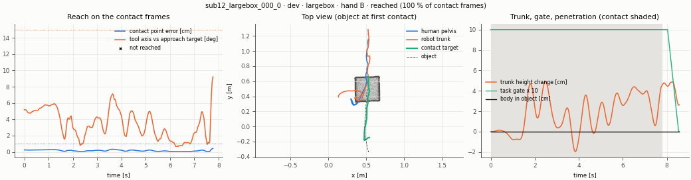
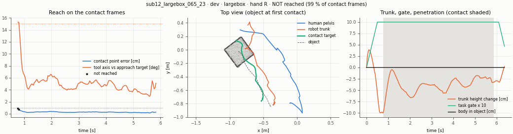
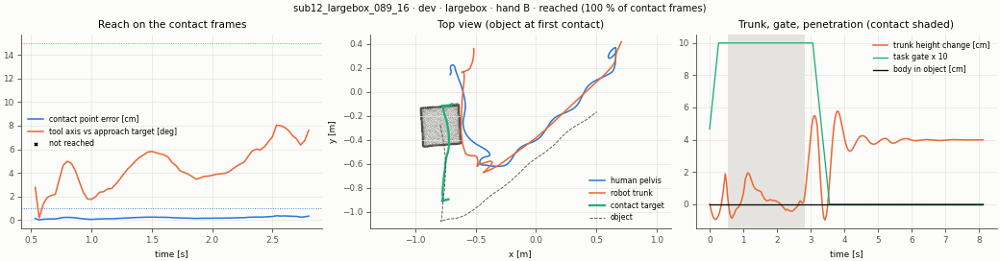
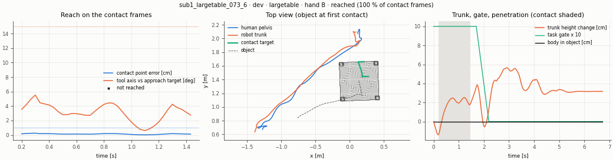
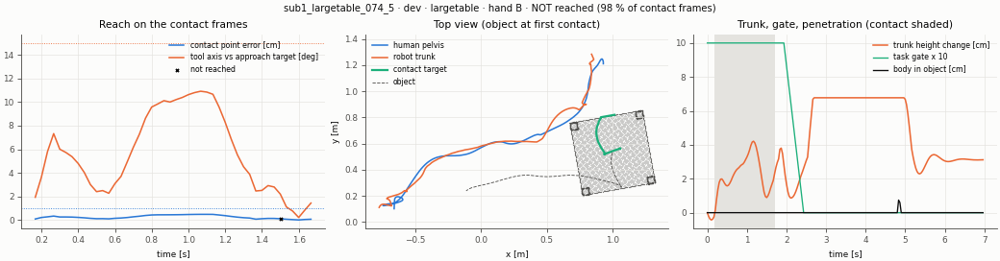
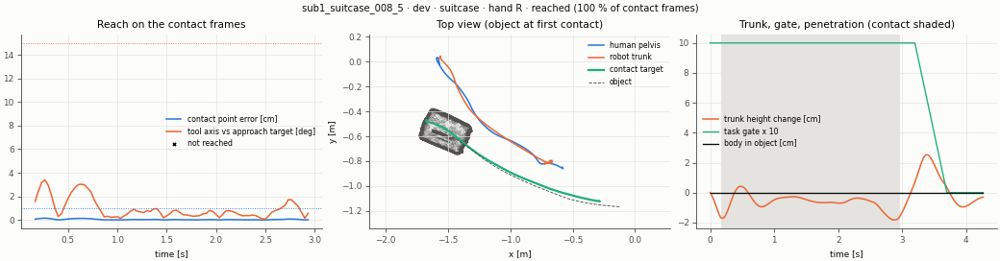
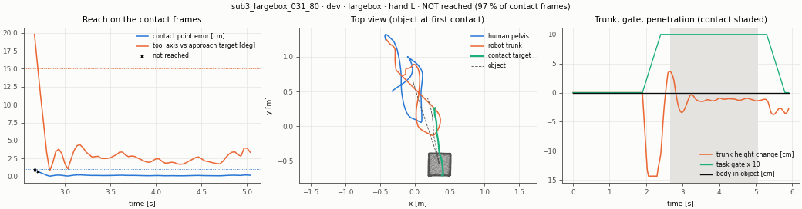
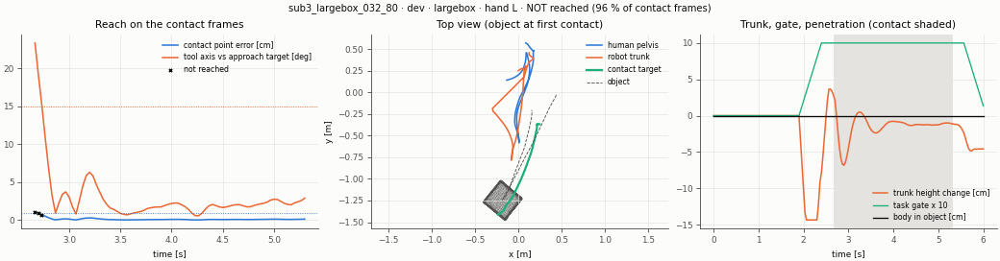
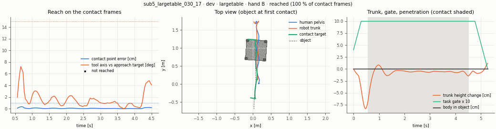
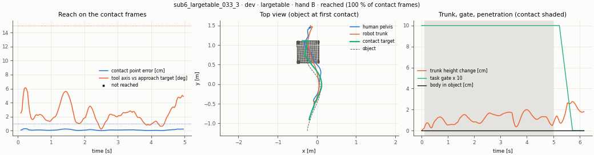
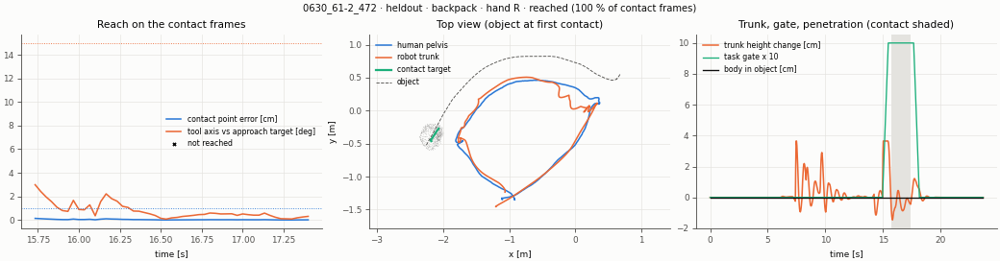
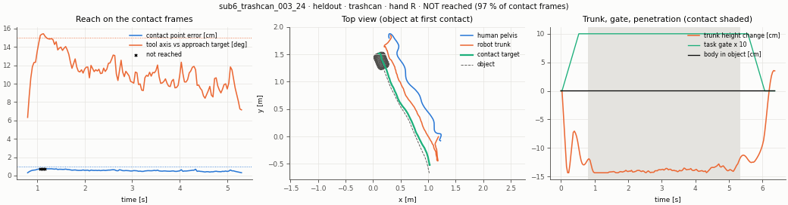
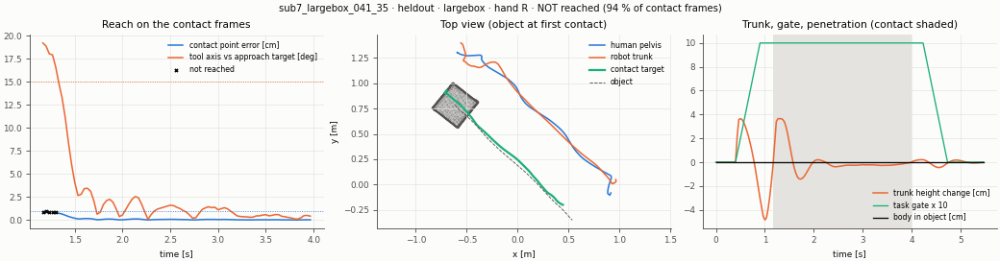
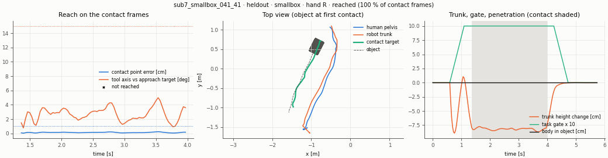
