# M1, M1g: full optimization, pass 1, relation (a) (fullopt spec v0.2 §7, §8.1, §8.6)

Run `R030_fullopt_press` · code `v0.3.4-4-g87eeeac` (dirty=False) · 14 clips · relation (a) · **PASS** (dev only; held-out reported apart)

| split | check | pass | detail |
|---|---|---|---|
| dev | all_clips_solved | True | n: 10, n_errors: 0, qp_failures: 0 |
| dev | reached | True | reached: 9, of: 10, min: 9, not_reached: ['sub6_largetable_033_3'] |
| dev | collision_free_all_frames | True | frames: {} |
| dev | body_in_object | True | max_m: 7.0785377162541074e-06, not_reached: {'sub6_largetable_033_3': 3.040401863607656e-07} |
| dev | object_under_body | True | frames: {}, not_reached: {'sub6_largetable_033_3': 0} |
| dev | feet_on_floor | True | sole_height_max_m: 0.0010351644569342733, not_reached: {'sub6_largetable_033_3': 0.001011295451916444} |
| dev | trunk_within_limits | True | ratio_max: 1.0033941813556684, not_reached: {'sub6_largetable_033_3': 1.0006690316860698} |
| dev | converged | – | unconverged_frames: {} |
| dev | targets_agree_with_learned | True | failing_or_missing: [] |
| heldout | all_clips_solved | True | n: 4, n_errors: 0, qp_failures: 0 |
| heldout | reached | – | reached: 4, of: 4, min: None, not_reached: [] |
| heldout | collision_free_all_frames | True | frames: {} |
| heldout | body_in_object | False | max_m: 0.024361276205609655, not_reached: {} |
| heldout | object_under_body | False | frames: {'0630_61-2_472': 5}, not_reached: {} |
| heldout | feet_on_floor | True | sole_height_max_m: 0.0011993172087056136, not_reached: {} |
| heldout | trunk_within_limits | True | ratio_max: 1.0084387825151966, not_reached: {} |
| heldout | converged | – | unconverged_frames: {} |
| heldout | targets_agree_with_learned | False | failing_or_missing: ['0630_61-2_472', 'sub6_trashcan_003_24'] |

Reached: contact point within 1 cm, tool axis within 15° and collision free on every contact frame (the learned line's definition). Body in object: deepest trunk or leg sample inside the object's hull, all frames / contact frames. Collision: frames where a self pair, or any geom but the soles through the floor, penetrates beyond 2 mm (all frames), and the closest self pair / geom to the floor. Under body: frames where the object's hull overlaps the box under the trunk (thicker than the penetration tolerance) and the thickest overlap. Feet: the largest horizontal path of a sole (they slide: no gait before M3); every sole is within 2 mm of the floor. Trunk: largest vertical speed, vertical and horizontal acceleration (limits 0.3 m/s, 3 and 5 m/s²) and tilt (15°). The body checks (body in object, under body, feet, trunk) are taken over the clips the reach check does not already count as failed; those clips' values are listed apart (not_reached). Relations: the fixed evaluation network on the contact frames. Unconverged: frames whose SQP stopped at the iteration cap, or on the trust-region floor with a row violated (reported, not a pass criterion).

| split | task | object | hand | reached (frames) | err max [cm] | angle med / max [°] | body in object all / contact [cm] | under body: frames, [cm] | collision: frames, self / floor min [mm] | foot slide [m] | trunk vz [m/s], az / a [m/s²], tilt [°] | edge / heading [°], same side | targets vs learned: pos med [cm], tool x [°] | unconverged / rejected | ms / frame | learned mesh: reached, edge / heading [°], body [cm] |
|---|---|---|---|---|---|---|---|---|---|---|---|---|---|---|---|---|
| dev | sub12_largebox_000_0 | largebox | B | True (100 %) | 0.4 | 3 / 9 | 0.0 / 0.0 | 0, 0.0 | 0, 5.0 / 45.6 | 1.74 | 0.20, 1.9 / 5.0, 1.1 | 4.8 / 14.7, 1.00 | 0.1, 0.0 | 0 / 10 | 28 | False, 2.7 / 2.0, 0.0 |
| dev | sub12_largebox_065_23 | largebox | R | True (100 %) | 0.2 | 1 / 3 | 0.0 / 0.0 | 0, 0.0 | 0, 4.9 / 46.4 | 1.82 | 0.09, 2.0 / 5.0, 2.6 | 13.4 / 15.9, 1.00 | 0.6, 0.0 | 0 / 23 | 31 | True, 5.9 / 11.9, 0.0 |
| dev | sub12_largebox_089_16 | largebox | B | True (100 %) | 0.4 | 2 / 8 | 0.0 / 0.0 | 0, 0.0 | 0, 5.0 / 45.3 | 3.28 | 0.30, 3.0 / 5.0, 2.2 | 5.1 / 15.5, 1.00 | 0.1, 0.0 | 0 / 34 | 35 | True, 6.3 / 1.7, 0.0 |
| dev | sub1_largetable_073_6 | largetable | B | True (100 %) | 0.6 | 3 / 10 | 0.0 / 0.0 | 0, 0.0 | 0, 4.9 / 45.8 | 3.19 | 0.23, 2.7 / 5.0, 1.4 | 8.5 / 5.5, 1.00 | 0.6, 0.0 | 0 / 19 | 34 | True, 6.2 / 1.2, 0.0 |
| dev | sub1_largetable_074_5 | largetable | B | True (100 %) | 0.6 | 7 / 12 | 0.0 / 0.0 | 0, 0.0 | 0, 4.8 / 42.9 | 3.25 | 0.28, 3.0 / 5.0, 3.8 | 5.2 / 13.0, 1.00 | 0.3, 0.0 | 0 / 9 | 30 | True, 7.1 / 3.0, 0.0 |
| dev | sub1_suitcase_008_5 | suitcase | R | True (100 %) | 0.2 | 1 / 4 | 0.0 / 0.0 | 0, 0.0 | 0, 4.7 / 47.1 | 1.95 | 0.14, 1.4 / 2.8, 1.1 | 2.0 / 13.5, 1.00 | 0.4, 0.0 | 0 / 11 | 61 | True, 3.2 / 3.0, 0.0 |
| dev | sub3_largebox_031_80 | largebox | L | True (100 %) | 0.4 | 4 / 8 | 0.0 / 0.0 | 0, 0.0 | 0, 5.0 / 39.3 | 3.27 | 0.30, 3.0 / 5.0, 15.0 | 5.5 / 21.2, 1.00 | 0.3, 0.0 | 0 / 85 | 48 | True, 4.9 / 19.4, 0.8 |
| dev | sub3_largebox_032_80 | largebox | L | True (100 %) | 0.4 | 3 / 8 | 0.0 / 0.0 | 0, 0.0 | 0, 4.9 / 40.2 | 3.12 | 0.30, 3.0 / 5.0, 15.0 | 5.0 / 24.2, 1.00 | 0.6, 0.0 | 0 / 68 | 41 | True, 6.2 / 24.3, 0.0 |
| dev | sub5_largetable_030_17 | largetable | B | True (100 %) | 0.9 | 1 / 13 | 0.0 / 0.0 | 0, 0.0 | 0, 5.0 / 45.7 | 2.02 | 0.26, 3.0 / 5.0, 1.7 | 4.3 / 8.0, 1.00 | 0.1, 0.0 | 0 / 14 | 30 | True, 5.9 / 1.1, 0.0 |
| dev | sub6_largetable_033_3 | largetable | B | False (94 %) | 3.7 | 2 / 31 | 0.0 / 0.0 | 0, 0.0 | 0, 4.9 / 46.4 | 2.78 | 0.30, 3.0 / 5.0, 5.1 | 4.6 / 14.9, 1.00 | 0.2, 0.0 | 0 / 67 | 51 | True, 9.9 / 2.2, 0.0 |
| heldout | 0630_61-2_472 | backpack | R | True (100 %) | 0.1 | 1 / 2 | 2.4 / 0.0 | 5, 2.9 | 0, 4.9 / 42.4 | 9.11 | 0.27, 3.0 / 5.0, 6.6 | 6.0 / 45.7, 1.00 | 5.7, 2.5 | 0 / 2 | 22 | – |
| heldout | sub6_trashcan_003_24 | trashcan | R | True (100 %) | 0.6 | 11 / 12 | 0.0 / 0.0 | 0, 0.0 | 0, 5.0 / 42.4 | 2.86 | 0.19, 3.0 / 4.3, 3.7 | 7.5 / 13.0, 1.00 | 2.7, 3.2 | 0 / 15 | 52 | – |
| heldout | sub7_largebox_041_35 | largebox | R | True (100 %) | 0.1 | 1 / 3 | 0.0 / 0.0 | 0, 0.0 | 0, 5.0 / 47.3 | 2.34 | 0.04, 1.0 / 2.6, 0.5 | 12.4 / 6.9, 1.00 | 0.3, 0.0 | 0 / 5 | 25 | – |
| heldout | sub7_smallbox_041_41 | smallbox | R | True (100 %) | 0.3 | 2 / 5 | 0.0 / 0.0 | 0, 0.0 | 0, 5.0 / 44.1 | 3.70 | 0.30, 3.0 / 4.0, 2.7 | 18.7 / 7.5, 1.00 | 0.4, 0.0 | 0 / 25 | 44 | – |

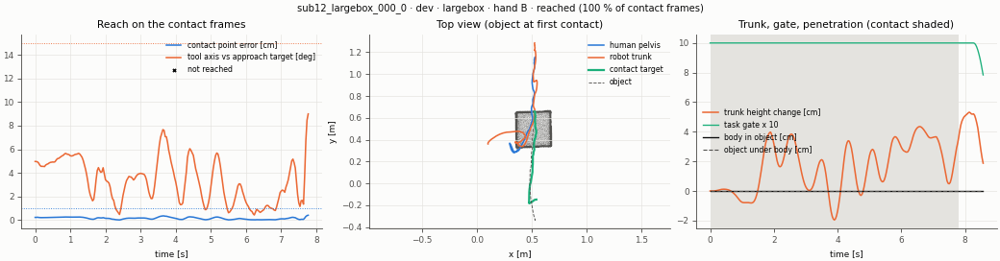
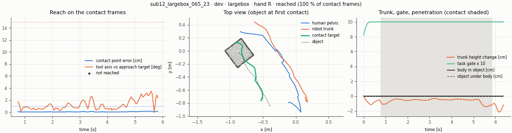
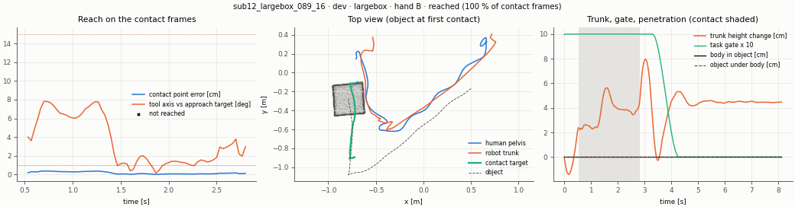
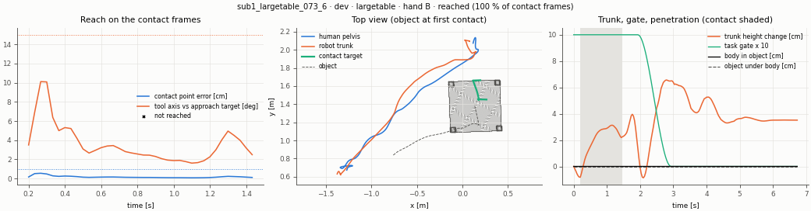
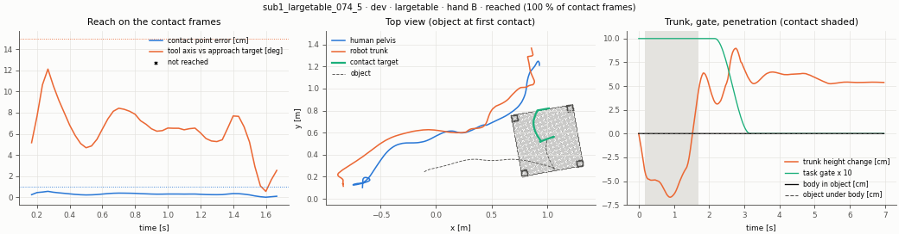
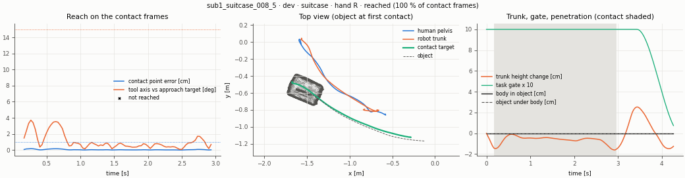
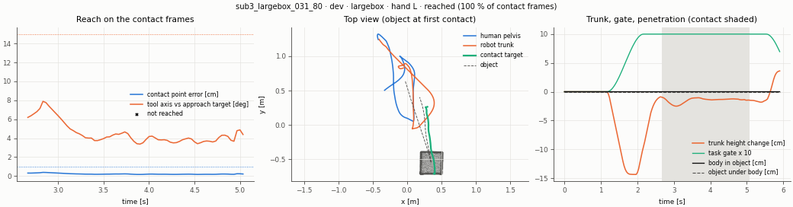
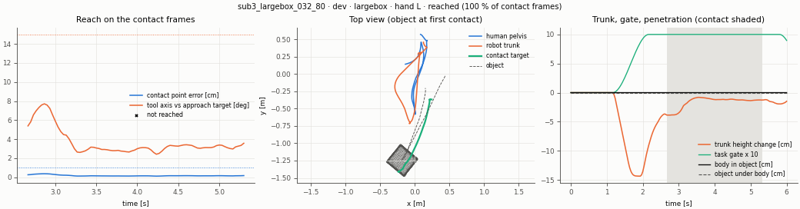
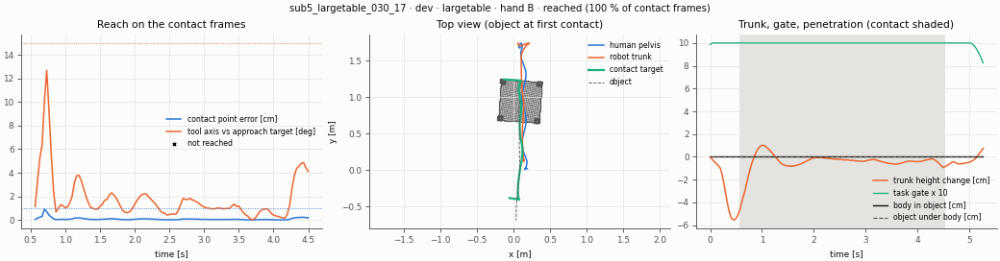
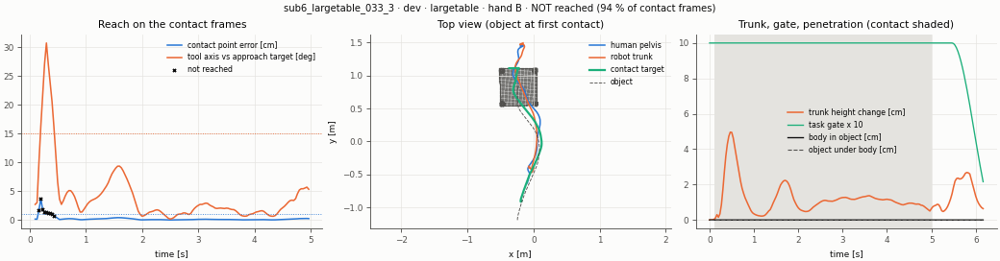
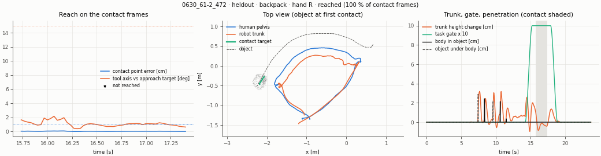
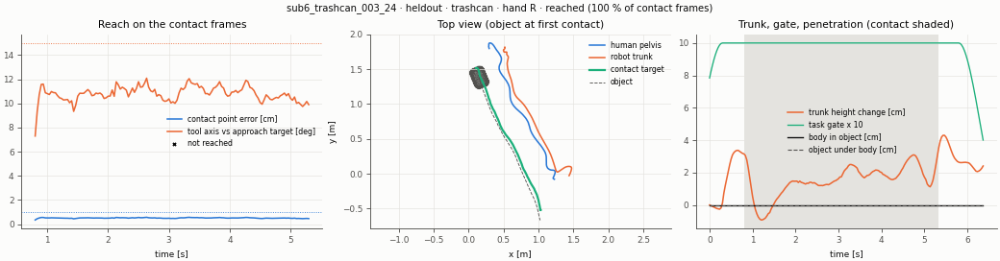
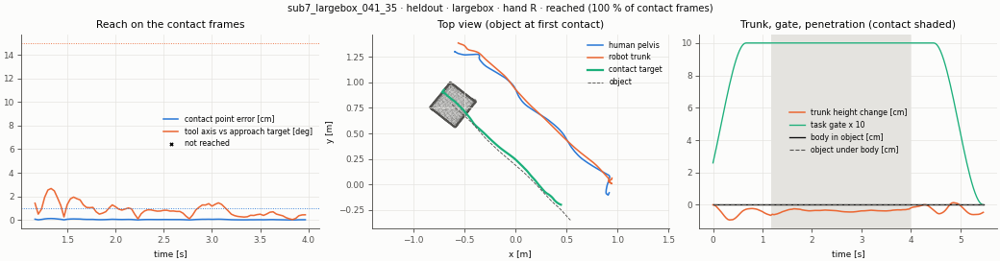
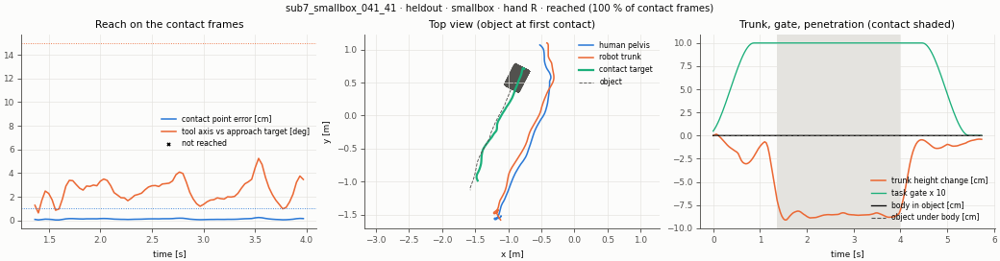
